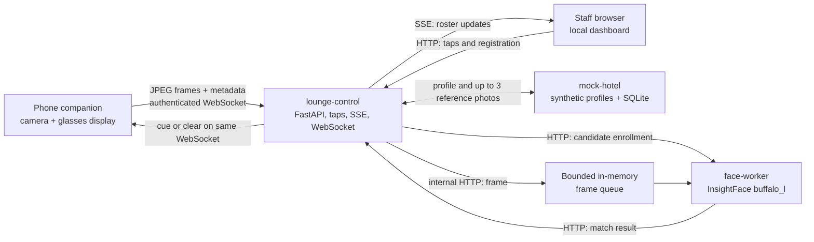
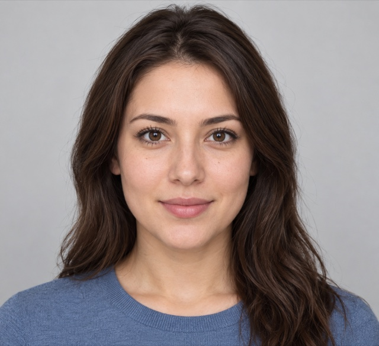
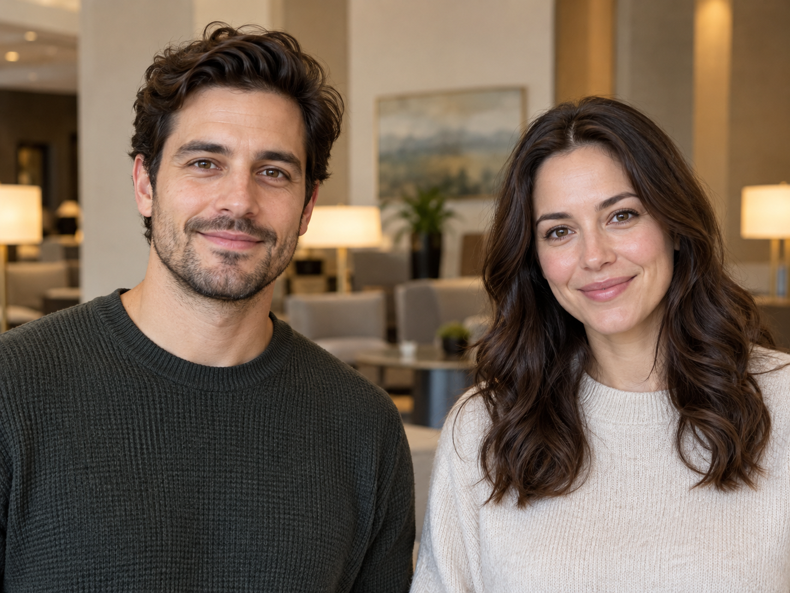

# Face-recognition POC: architecture and demo

**Status:** Local development baseline. The glasses-to-phone camera path is still a proposal and needs validation on the target Rokid device.

## System shape

The POC runs on one laptop with three core Docker Compose services. One `lounge-control` instance can serve multiple paired phones; each phone has its own authenticated WebSocket session.

The **active lounge cohort** is the set of guests currently admitted to the lounge. Guest references and limited display fields live in `lounge-control`; `face-worker` receives opaque candidate IDs and temporary face templates.

### Recognition flow

1. An entry tap tells `lounge-control` to fetch the guest profile and up to three reference photos from `mock-hotel`.
2. `lounge-control` sends the photos and an opaque candidate ID to `face-worker`. The worker derives one embedding per usable photo and keeps those templates in memory while the guest is in the active lounge cohort; submitted photo bytes are discarded after enrollment.
3. The phone sends sampled JPEG frames plus stream metadata to `lounge-control` over its WebSocket.
4. `lounge-control` validates each frame and forwards it over internal HTTP to the worker's bounded queue. If inference falls behind, the queue drops old frames rather than building latency.
5. `face-worker` detects faces, tracks them between frames, and compares their embeddings with templates for the active lounge cohort. A unique candidate must remain stable for three observations before a match is emitted.
6. `lounge-control` turns a match into a short cue and returns it to the phone over that same WebSocket. Exit or expiry removes the candidate template.

The browser dashboard is a separate staff control surface: it sends tap and guest-registration requests over HTTP and receives roster updates over SSE. Its local **Face Recognition Test** is also a diagnostic WebSocket client: it displays each `face_crop` image beside its matching `detection_set` guest entry, including guest ID, temporary track ID, preferences, and allergies. This is a preview of the data a phone client should join and render; there is not yet an Android glasses companion app.

## Models

The worker uses InsightFace with CPU ONNX Runtime on the laptop; it does not call a hosted recognition service.

- **`buffalo_l`** combines SCRFD-10GF face detection and landmarks with a ResNet-50 / ArcFace recognizer. It returns a normalized 512-value embedding for each face. [InsightFace model zoo](https://github.com/deepinsight/insightface/blob/master/python-package/docs/model_zoo.md)
- `face-worker` enables only detection and recognition from the package; it does not run the bundled age or gender models.

InsightFace downloads the model package on first startup into the named `face-model-cache` Docker volume. The container installs InsightFace 2.1.0 with the CPU `onnxruntime` and headless OpenCV packages.

Current POC settings are a `0.65` cosine threshold, a `0.10` margin over the next candidate, and three stable observations. `0.65` follows the official recognition example as a starting point; it is not validated on the project's images and must be tuned on varied, consented test images. [InsightFace example](https://github.com/deepinsight/insightface/blob/master/examples/face_recognition/insightface_app.py)

## Local demo

The seeded Alex profile uses the fictional generated test portrait below. Other seeded guests use a person-free placeholder.

1. Start the core services: `docker compose up --build --wait`.
2. Open `http://127.0.0.1:8000/` and admit Alex.
3. Run `docker compose --profile sim run --rm frame-replay`.

The one-shot replay sends three frames through the same WebSocket route used by a phone bridge. In the local smoke run, it returned an `ALEX` cue with the seeded allergy alert. The reference and replay use the same synthetic image, so this checks pipeline wiring and stable-match behavior; it does not measure recognition accuracy across people, lighting, or camera angles.

The staff page is served at `/` by `lounge-control`. Its visible sections are:

- **Guest Tap Ingress:** select a seeded guest, edit the guest reference, and send Admit or Depart taps.
- **Register Mock Hotel Guest:** add a synthetic profile and upload/capture up to three reference photos. Use clear, single-face images; the local mock-hotel database retains them for re-enrollment.
- **Active Lounge Roster:** see admitted guest names and admission times, refreshed through SSE.
- **Face Recognition Test:** send a picture or three distinct camera frames through the device WebSocket and view the returned crops and metadata together. Results stay in the browser until the next test; server-side detections and crops expire after five seconds.

### Synthetic two-person test

The repository contains a generated two-person lounge scene and a single-person reference crop for each synthetic guest:

1. Register two test guests in the dashboard. Use `fixtures/synthetic_guest_left.jpg` for the left person and `fixtures/synthetic_guest_right.jpg` for the right person. Give them distinct names and optional preferences/allergies.
2. Admit both guests using **Guest Tap Ingress**. Registration alone does not add a guest to the active lounge cohort.
3. In **Face Recognition Test**, choose `fixtures/synthetic_multi_face.png`, enter the device token from `.env`, and select **Send picture test**.
4. Inspect **People returned to this client**. Each stable match should appear as its own card with the cropped face, `guest_id`, `track_id`, name, preferences, and allergies. The images arrive as separate `face_crop` messages and are joined to people in `detection_set` by `crop_id` (with `track_id` linking the person to a live face track).

The picture button sends the same synthetic still three times so the existing three-observation stability gate can be exercised. This is a repeatable wiring/demo check, not an accuracy evaluation or evidence that three independent camera observations were captured. The mock-hotel registration stores these synthetic reference photos in its Docker volume; `docker compose down -v` removes the local database and cached model along with other named volumes. Because a `face_crop` and its `detection_set` reference may have an unrelated periodic snapshot between them, clients retain unreferenced crops for up to five seconds and refresh that timer when a snapshot references the crop.

The current `test_one_stream_returns_multiple_guest_profiles_and_face_crops` test verifies the two-person WebSocket contract using controlled face-worker callbacks: two guest entries, two crop images, and two cues. It does not run the recognition model on `synthetic_multi_face.png`. A real model-backed image test requires the face-worker dependencies and model cache to run in Docker.

On 2026-10-16, the local Docker stack was also run with the generated two-person scene and the two matching reference crops. `buffalo_l` returned two different synthetic guest IDs, two face tracks, two JPEG crops paired by `crop_id`/`track_id`, both profiles' preferences, and the left guest's peanut-allergy cue. This confirms the model and message path work for this particular synthetic image; it does not establish recognition accuracy on real guests or varied camera conditions.

For implementation details, see [the face-worker pipeline](../../apps/face-worker/vision.py), [frame replay](../../apps/frame-replay/main.py), and [the POC model notes](../../apps/face-worker/MODELS.md). The multi-photo enrollment and allergy-cue source review is in [face enrollment and allergy cue](../research/face-enrollment-and-allergy-cue.md).
