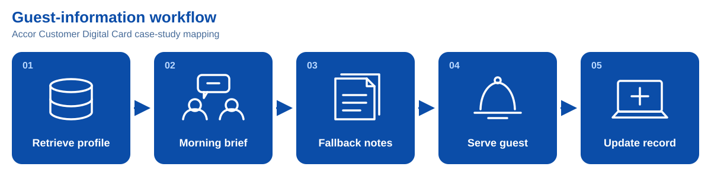
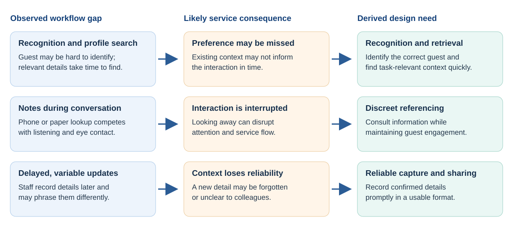

# Guest-context cues for personalised hotel service

**CDE4301 Innovation & Design Capstone · Interim assessment · Team IS-432**  
**Team:** Neha Rajan · Tan Ping Hui · Wong Weng Hong · Nigel Yeo Tong Wei  
**Presentation:** 5 November 2026 · **Report prepared:** 10 November 2026 · **Revised:** 14 November 2026  
**Case setting:** PARKROYAL club lounge · **Stage:** Semester 1 proof of concept

<!-- REPORT_BODY -->

## Executive summary 
Hotels may collect guest preferences without making them available at the next service moment. This project investigates same-stay guest-context capture and reuse in a lounge, including for first-time guests with limited service history.

Semester 1 produced a working smart-glasses recognition-and-display prototype, a separate lounge-services scaffold, early preference-extraction experiments, and formative testing. The glasses app recognises against a loaded gallery and displays a name with fictional preference or allergy cues. Automatic conversation-to-profile updating and task-based cue selection are not integrated. [P1](#p1), [P3](#p3)

Four successful warm frame commits averaged **1.18 seconds** from handled temple tap to Android submission; this cannot establish p95 or physical lens visibility, and the report adopts the supplied slide's **<1 s** target. The revised speaker script uses the same target; an earlier draft said **1.5 s**. A 20-minute comparison reported battery-gauge drops of **28 versus 9 percentage points** for continuous and triggered operation. In a walkthrough with **10 non-hotel participants**, all found activation easy and 70% saw potential usefulness, while natural cue use remained difficult. These findings guide further prototyping; they do not establish recognition accuracy, improved guest satisfaction, or hotel performance. Next, the team should test extraction, cue relevance, and the complete handover against ordinary profile lookup with hotel staff. [P1](#p1), [P4](#p4), [P7](#p7)

## 1. Introduction
How do hotel guests decide where to stay? Various factors influence these decisions, including price, reviews, and ratings. Singapore is home to 400+ hotels [e]. Yet, in the luxury hotel industry, only 5 players have captured nearly 50% of the market [f]. A discussion with the partner hotel (Appendix E) revealed that the hotel’s revenue is decreasing significantly due to increasing manpower and operational costs. Hence, this project aims to explore how luxury hotels generate revenue to become key players.

## 2. Problem Identification
### 2.1 Iterations: Manpower and Satisfaction Stagnation
Based on interviews across various hotels in Singapore, manpower shortages and retention was identified as a common issue (Appendix). The shortage often leads to cognitive overload among staff, preventing them from meeting certain service standards (Appendix). In recent years, this has led to a stagnation in guest satisfaction, driven by rising customer expectations (Appendix). Iterating through these problems led to the conclusion that all these issues contribute to the overarching problem faced by the industry partner: revenue generation.

### 2.2 The Revenue Problem
While revenue can be increased by decreasing costs, this can compromise the quality of luxury services in an industry already struggling with external factors driving up cost. Hence, profit generation will be the aim of this project. Revenue in hotels is measured by Revenue Per Available Room (RevPAR) [source]. It is represented by 

RevPAR = ADR OR

Where ADR represents Average Daily Rate of the hotel [source] and OR represents Occupancy Rate [source]. While there are common factors affecting both, such as location, season, economic conditions, and competitor landscape, the classification (star rating) of a hotel significantly affects ADR while reputation and reviews affect OR [source].

#### 2.2.1 ADR and Service Quality
Ratings of hotels depend on their quality, and are assessed by the Leading Quality Assurance (LQA) framework [source]. While these criteria span across emotional intelligence, service quality, efficiency, and more, a large number of standards strongly link to personalized service. Currently, there is a gap in delivering human-centered service, with the partner claiming that staff fail to notice emotional cues like sick guests in the lobby (Appendix).

#### 2.2.2 OR and Customer Satisfaction
Hotel reputation and reviews depend on customer satisfaction. Satisfaction drives increased retention rate and guest acquisition–measured by an increase in Net Promoter Scores (NPS) [source]. This subsequently increases hotel occupancy rate. Satisfaction significantly increases loyalty, as shown by a guest survey (Appendix) in consensus with Marriot’s occupancy analysis (Figure). However, the industry partner is facing “single-digit retention rates” (Appendix).

Guest satisfaction has stagnated over the past few years (Figure) [source], due to rising guest expectations. Different guest demographics expect different services and amenities [a]. Scaling automations to increase overall satisfaction leads to standardization, failing to address the unique expectations of the individual [b].

#### 2.2.3 The Need for Personalization
Hence, it is established that revenue depends on both service quality (driving ADR), which demands interpersonal service and customer satisfaction [Medallia] (driving OR) which requires addressing individual expectations. Synthesizing these needs leads to the demand for personalization in the luxury hotel industry.

This is further supported by the following:
> **86% of travelers sought at least 1 aspect of their experience to be personalized [c]**
> **61% of consumers are willing to spend more for personalized experiences [d]**
> **87% of guests are more likely to recommend a hotel if they receive a personalized experience (Appendix)**

The broader case for personalised hotel service leads to an operational question: can staff obtain and use relevant guest information at the moment it is needed? In a Medallia survey of 1,749 hotel guests, 23% rated their recent stay 9 or 10 for personalisation, while recall of the surveyed in-stay elements averaged 46%. Perceived personalisation was associated with satisfaction, although the survey does not establish that access to guest data caused either outcome. The finding directs attention to service encounters, where recorded information must become a useful staff action. [R2](#r2)

### 2.3 Current guest-information workflow
#### 2.3.1 Accor Customer Digital Card (ACDC) Case Study
The Accor Customer Digital Card case study maps a five-stage information cycle. A general manager retrieves guest details from a database and communicates relevant points in a morning briefing. Hard-copy or WhatsApp notes can serve as a fallback when staff need to check a detail. During service, staff draw on the briefing or profile while learning new preferences or concerns through conversation. They enter newly learned details into the database afterwards, potentially making them available for later encounters. [P1](#p1) This sequence is a case-study mapping, not a measured description of every hotel or of PARKROYAL's daily operations.

<figure>

<figcaption><strong>Case-study workflow.</strong> The mapped Accor Customer Digital Card sequence. [P1](#p1)</figcaption>
</figure>

Information must cross several human and system handoffs in this cycle. Staff need to remember or find the right profile, select a detail relevant to the immediate interaction, and record new information accurately enough for another employee to use. A stored profile therefore has limited service value if access is slow, consultation interrupts conversation, or updates arrive after the next encounter.

Information may already exist but remain difficult to act upon because it is separated from the service task, carried in a briefing that staff must remember, or entered only after the encounter has ended. Each route puts a different demand on staff: recall, search, or delayed documentation. These demands are especially consequential during short face-to-face exchanges, when there is little time to recover a missed detail.

#### 2.3.2 The Gaps

The guest-journey mapping identifies three related gaps. First, recognising a guest from a description or profile photograph and filtering the profile can be difficult; a stored preference may consequently be missed. Second, consulting notes or a phone during conversation can divert attention from the guest while staff are expected to listen and engage naturally. Third, a busy employee may postpone an update, and different staff may phrase the same information differently, reducing its reliability for colleagues. [P1](#p1)

Guest identification and information relevance are distinct problems. Finding a profile quickly is insufficient if it belongs to the wrong person; finding the correct profile is also insufficient if staff must search through unrelated details while serving the guest. A preference about a drink may matter at the lounge, whereas a room-setting preference may not. The design need is therefore timely access to the *right* information for the *right* guest and task. This is a design inference from the mapped journey, not evidence that a particular retrieval method will improve service.

<figure>

<figcaption><strong>Problem-analysis diagram.</strong> Workflow gaps, likely service consequences, and derived needs. The arrows represent the team's design reasoning, not measured causal effects.</figcaption>
</figure>

The resulting needs are **recognition and rapid retrieval**, **discreet referencing during service**, and **prompt, consistent capture of confirmed information**. They form a connected information cycle: the correct guest must be identified before a cue is useful, and a new detail must be recorded in a usable form before it can support a later interaction.

#### 2.3.3 The First-Time Guest Problem

Returning guests may have accumulated preferences and established rapport; first-time guests may have booking or pre-arrival details but less recorded service history. Their initial encounter is therefore an important opportunity to learn a specific, guest-confirmed detail. If that detail is captured and shared in time, another employee could use it during the same stay. If it remains only in one staff member's memory, the next interaction begins with much of the same information gap.

This creates a possible feedback pattern: limited history offers fewer cues for tailoring service, while failure to capture what is learned leaves the history limited. The pattern is a hypothesis, rather than an established explanation of guest behaviour. It also shows why the first stay is a useful test case. The goal is not to build a complete long-term profile immediately; it is to determine whether one relevant detail from an early interaction can reach a later employee accurately and in time to inform their service.

An industry-partner account reported a single-digit first-time guest retention figure, but its cohort, definition, and time period were not supplied. It is treated here as a preliminary observation, not a verified baseline or evidence that limited personalisation caused low retention. [P1](#p1) The proposed same-stay handover is consequently a design opportunity to test, rather than a demonstrated route to higher return visits.

### 2.4 Design Challenge

The problem is to make guest context available across encounters while preserving natural service. For the first employee, this means recognising the guest and recording an explicit preference or concern with sufficient context. For the next employee, it means finding the correct, relevant detail quickly enough to act on it appropriately.

The intended value differs across the service relationship. Staff may spend less effort recalling briefings or searching notes; guests may experience greater continuity between interactions; and the hotel may have a more dependable basis for consistent personalised service. The next stage must establish whether faster access and more reliable sharing actually help staff make better service decisions without adding disruption or creating incorrect guest associations. These needs lead to the project's design question:

> **How might we enable luxury hotel staff to capture, share, and access relevant guest information seamlessly so that they can deliver consistent, personalised, high-quality service?**

These problem findings lead to the functions, service criteria, and boundaries in [Chapter 3: Aim, scope, and requirements](#requirements).

<b>01 · Capture</b>A guest states a preference.<small>Emerging capability</small>

<b>02 · Check & share</b>Staff confirm the guest and meaning.<small>Planned approval workflow</small>

<b>03 · Retrieve</b>The next employee sees relevant context.<small>Demo profiles implemented</small>

<b>04 · Adapt</b>Staff make a suitable offer and confirm it.<small>Service benefit to evaluate</small>

## 3. Aim, scope, and requirements {#requirements}

The design question is:

> How might we enable luxury-hotel staff to capture, share, and access relevant guest information seamlessly, so they can deliver consistently personalised, high-quality service?

**First-time guest use case.** A first-time guest may already have booking or pre-arrival information, but often has less recorded service history for staff to draw on. The design target is to use an early interaction to establish one useful, guest-confirmed detail for the current stay, then make it available to another employee when relevant. This does not assume every new guest has no information or that a single comment is an enduring preference. A visit-specific request remains scoped to that encounter or stay unless the guest or an authorised record confirms otherwise. The lounge prototype explores recognition, retrieval, and concise cues using fictional profiles and manual activation; production PMS integration and demonstrated service outcomes remain outside the current evidence. [P1](#p1), [P3](#p3)

**Functional requirements.** The solution has two linked functions: capture and process guest context, then select and display the information staff need for the current service moment.

| Function | Required behaviour and boundary |
|---|---|
| **Capture and process** | Record a guest-stated preference, request, or concern with its source and time. Keep explicit statements distinct from staff observations and model inferences; retain enough supporting wording for staff to review a draft. |
| **Associate and prepare** | Associate a draft with a likely guest and current stay only when the evidence is sufficiently strong. Keep the scope, source, timestamp, and review state. If identity or meaning is uncertain, ask staff to resolve it or leave the information unlinked. |
| **Review and carry forward** | Let staff correct the wording, confirm the guest and stay, and approve the record before it becomes shared context. Make a confirmed detail available to another employee; do not silently convert a one-off request into a permanent preference. |
| **Select and display** | Select the smallest detail relevant to the current service task and show it as a concise, actionable cue. Do not display raw transcripts or unrelated profile fields. Suppress personal cues when a match is uncertain, and retain normal greeting or manual profile lookup as the fallback. |

This makes the first-time guest goal explicit: one early, confirmed detail can support a later interaction during the same stay, even before a long service history exists. In the proposed complete workflow, one deliberate tap starts recognition and conversation capture together. Audio capture, reviewed record updates, and the complete next-employee handover are not integrated in the current glasses path; any recording study also needs an approved purpose and participant protocol. The current demonstration covers narrower recognition, prepared-profile retrieval, and cue-display stages. [P1](#p1), [P3](#p3)

**Service criteria and proposed measures.** The project-selected PARKROYAL F&B LQA subset includes acknowledgement within one minute of lounge entry and an offer to take a drinks order within three minutes of seating. These are staff-action windows, not system-latency targets. The selected 15-item table is a departmental subset rather than a complete audit or an official LQA score; LQA assessment is also distinct from hotel star classification. [P8](#p8), [R4](#r4)

| Criterion | Service behaviour | Requirement and proposed measure |
|---|---|---|---|
| **DR1 · On-time service support** | Timely acknowledgement and offer of service. | Make the first correct, readable cue available within **1 second** of deliberate activation when a supported guest match and relevant context are available. Measure activation-to-first-correct-visible-cue latency, target-attainment rate, and late, missing, or incorrect cues; separately time the staff service action. |
| **DR2 · Low-effort capture** | Active listening and natural engagement. | Start capture with one deliberate action and avoid lengthy note-taking. Measure activation and capture time, actions, correction effort, and disruption to conversation. |
| **DR3 · Glanceable interaction** | Natural, friendly engagement and discreet use of the guest's name. | Keep the cue short and understandable during conversation. Measure correct comprehension, glance duration, attention shifts, and interruption. |
| **DR4 · Preference continuity** | Use confirmed context to personalise service. | Preserve source, time, stay scope, and review status. Measure whether the correct approved detail reaches another employee in time and is interpreted correctly. |

**Cross-cutting safeguards.** DR5 suppresses personal cues for unknown, ambiguous, lost, or stale tracks. DR6 minimises displayed fields, distinguishes preferences from allergies, and keeps a manual fallback. An allergy cue is a prompt to check the authorised guest record and the relevant menu or kitchen source; a face match does not establish that food is safe.

**Timing rationale and boundary.** The report adopts **less than 1 second** as a proposed cue target, aligned with the supplied slide. Shiwa et al. (2009) found that preference for a communication robot's response peaked at one second. Applying that result to a visual hotel-service cue is an analogy to test, not a smart-glasses standard or an LQA requirement. [R12](#r12)

For the visual prototype, timing starts when staff deliberately activate the interaction and ends when the first correct, readable cue appears on the glasses. This end-to-end interval includes capture, guest association, transfer, and rendering; measuring server processing alone would omit important delays. Keep cold and warm trials, count all valid attempts, and report latency distributions (including p50 and p95), target attainment, late or missing cues, and incorrect cues separately. On unknown-guest trials, assess correct suppression and fallback rather than expecting a personal cue.

Four successful warm frame commits averaged **1.18 seconds**. That small successful-only set exceeds the proposed one-second target but cannot establish the complete trigger-to-visible-cue latency, target-attainment rate, p95 performance, or physical lens visibility. [P3](#p3), [P4](#p4)

These requirements define the functions and safeguards that each concept must support. [Chapter 4: concept generation and selection](#concepts) compares complete workflows against the same first-stay service scenario.

## 4. Concept generation and selection {#concepts}

The concepts address the same first-stay scenario: a guest shares a preference early in the stay, and another employee needs it during a later service interaction. We compare complete workflows while keeping guest information, task, and staff review support as consistent as possible. [P1](#p1)

| Comparison row | Phone/PMS baseline | Audio badge + earpiece | Camera-free glasses hybrid | Vision-assisted smart glasses |
|---|---|---|---|---|
| **Capture** | Staff enters a note in the existing profile after or during the interaction; familiar, but screen use and delayed entry may interrupt or lose detail. | A deliberate push-to-talk action captures speech hands-free; noise, speaker attribution, and correction needs require testing. | The microphone captures speech after a deliberate trigger; a companion interface selects or confirms the guest. | Triggered microphone capture adds visual context from the camera, with greater collection and battery demands. |
| **Guest and stay association** | Staff selects the guest and stay in the profile; the step is visible and correctable but takes time. | Staff still selects or confirms the guest and stay in a companion interface; speech does not identify its speaker by itself. | The same explicit selection avoids face matching and helps isolate the display's value. | Vision can suggest a guest match and reduce lookup when correct; ambiguous or unstable matches must not reveal profile details. |
| **Processing and review** | The existing profile workflow handles the note; the staff member checks what they entered. | A transcript can become a structured draft, but staff checks the wording and confirms the guest and stay before saving. | Use the same processing and staff-review path as the audio concept, so the display can be compared separately. | Use the same draft and review path; recognition is an association aid, not approval to save or act on an inferred preference. |
| **Cue delivery** | The phone offers profile detail but requires staff to look down and navigate. | A short earpiece cue can be private and hands-free; audibility, comfort, and comprehension in a noisy lounge need testing. | A concise in-lens cue keeps information near the line of sight without a camera. | A concise in-lens cue can follow a visual match, but may draw attention from the guest or affect eye contact. |
| **Staff effort** | Manual navigation and note entry add steps, though the workflow uses familiar equipment. | Capture is hands-free, but guest selection and companion-interface review remain. | Capture and glanceable display may reduce device switching; fitting, controls, and review still take effort. | It may combine capture, association, and cue delivery, while confirmation and camera/display setup add work. |
| **Privacy and comfort** | No new wearable sensor is needed, but viewing a profile in front of the guest may feel intrusive. | No camera is used; recorded speech still needs clear purpose, access, retention, and guest-notice decisions. | A microphone and display still affect privacy and comfort; removing the camera reduces visual collection. | Camera, microphone, and display create the greatest face-data, recording, comfort, and acceptance questions. |
| **Integration and fallback** | Uses the current profile and phone path, with manual lookup as the baseline. | Needs a reliable mic, speech processing, and earpiece; use phone/PMS if capture fails. | Also needs a working microphone, display, companion selection, and device link; fall back to phone/PMS. | Needs a validated camera/display link and safe matching against the active guest set; on uncertainty or device failure, suppress cues and use phone/PMS. |

The row-by-row comparison makes the trade-off clearer: audio capture avoids a camera but still needs reliable speaker and guest association; glasses can provide an eye-line cue, and the vision-assisted version may reduce manual lookup while introducing face-matching risk. The camera-free glasses variant is a useful control: comparing it with audio tests the display, while comparing it with vision-assisted glasses tests whether visual matching adds enough value to justify its cost and risk. These are hypotheses, not measured advantages.

### Why carry forward smart glasses as a package

The first-time-guest problem is not simply remembering a preference. A first-time guest may have little useful prior-stay history, and information shared in one encounter may not reach the employee handling the next. The concept therefore links five functions: capture what the guest says during service; associate it with the correct guest and current stay; turn it into a consistent draft with its source and uncertainty visible; let staff review and confirm it before saving; then select a task-relevant cue for a later service moment. Each function addresses a different break in continuity: without capture, the request can be lost; without correct association, it can be attributed to the wrong person; without review, an inference can be recorded as fact; without a concise cue, staff still need to stop and search the profile; without a confirmed handover, the next employee may not receive the useful detail. [P1](#p1)

Smart glasses are being prototyped as a package because a wearable workflow could combine staff-triggered capture, contextual association, and a concise cue near the service moment, while a companion review path carries confirmed information forward. This is a design hypothesis, not evidence that glasses outperform the alternatives. An audio badge and earpiece could also support hands-free capture and private cue delivery, but still need reliable guest/stay association, review, and handover. The phone/PMS is the familiar baseline and fallback. Camera-free glasses can help isolate whether the visual output adds value; vision-assisted glasses test whether matching adds enough value to justify its accuracy, privacy, comfort, and integration costs. The functions should be assessed individually and then as a complete workflow.

The specific reason to test the glasses display against an audio-only cue is that a short, silent fact or action prompt can be checked without adding another voice to the guest conversation and can remain available for a deliberate recheck. A cue such as “confirm unsweetened tea” can guide staff while leaving them to choose natural wording, rather than asking them to listen to and repeat a full script. This may fit a face-to-face service exchange. The trade-off is visual attention and reading load, with possible effects on eye contact. The display is a starting hypothesis to compare with equivalent audio, not a settled advantage.

### Visual cues compared with audio cues

The service encounter is already a conversation: staff need to listen, observe the guest, and decide when to speak or act. A cue is useful only if it supports that decision without making staff miss something more important. The comparison below isolates the **output channel** as far as possible; it is design reasoning, not a result from a hotel-staff trial.

A visual cue can keep a short detail available for a brief recheck without adding another spoken message. However, a heads-up display does not guarantee that attention remains on the guest. Lewis and Neider (2016) found that secondary information on Google Glass disrupted a concurrent visual-search task across five laboratory experiments. Their study did not test hotel conversations or compare earpieces, so it supports measuring interruption rather than assuming that a display is distraction-free. [R9](#r9)

An audio cue avoids reading a display and may help when staff are visually occupied or request information between conversational turns. But a spoken prompt that feeds staff a suggested sentence could become distracting if it arrives while the guest is speaking: the wearer must process the guest and a second verbal message, and may miss words or delay a response. Brungart (2001) found interference between simultaneous spoken phrases; applying this result to staff guidance through an earpiece is an inference, not a direct hotel study. A short factual prompt on request or during a pause is a testable alternative to a full spoken script. [R13](#r13)

Studies do not establish a universal winner. In a continuous visual-tracking experiment, Nees and Sampsell (2021) found simple visual alerts more disruptive to tracking than auditory tones; the auditory condition had lower workload when no noise was present. Ward, Smith, and Helton (2023) compared words delivered on an HMD, on the same visual plane as the task, or audibly: HMD and audio words both impaired manual tracking relative to tracking alone, while same-plane visual words did not. In a face-to-face AR-glasses study with 32 participants in 16 pairs, Rzayev et al. (2020) found that notification position and alignment affected how people perceived the notifications. Together, these studies suggest that cue content, placement, timing, ambient noise, and the task matter. None tests spoken service suggestions through an earpiece while hotel staff listen to guests, so they support a matched prototype trial rather than a claim that the screen is less distracting. [R14](#r14), [R15](#r15), [R16](#r16)

| Service question | Proposed visual-cue approach | Proposed audio-cue approach | What to compare |
|---|---|---|---|
| **Can staff keep listening?** | Show a small amount of information without adding speech. | Play a brief message on request or at a suitable pause. | Missed guest details, overlapping messages, and conversational interruptions. |
| **Can staff recover a missed detail?** | Keep the cue available briefly for a deliberate second glance. | Provide a simple replay action. | Recovery time, repeated glances or replays, and interpretation accuracy. |
| **What happens in difficult surroundings?** | Test contrast, placement, and readability against changing backgrounds. | Test intelligibility amid lounge noise and conversation. | Correct comprehension under matched quiet and busy conditions. |
| **Does the cue help the service action?** | Use a concise label or understood symbol tied to the task. | Speak the equivalent fact in a short phrase. | Correct offer or response, assistance required, and time until staff can act. |
| **Is it acceptable to wear and use?** | Assess fit, visual obstruction, perceived attention, and guest comfort. | Assess earpiece fit, environmental awareness, volume, and audio leakage. | Staff and role-play guest feedback, alongside observed task performance. |

For example, the same encounter could convey that a guest requested unsweetened tea earlier in the stay. One condition could show a short visual label; another could speak the equivalent phrase. Both must support the same decision: whether and how to confirm the preference now. Keep the information, task, capture and processing support, and guest-selection method constant while changing the output. For speech, measure both time to playback onset and time until the actionable fact has been conveyed. Google's AI-glasses guidance supports brief, glanceable elements that appear when needed and recede afterwards, but the project device still needs evaluation. [R8](#r8)

The audio badge and earpiece were discussed as an alternative concept; they were not implemented or comparatively tested. A camera-free glasses condition can help isolate the value of a visual cue from face matching, while a vision-assisted condition tests whether camera-based association adds enough value to justify its privacy, accuracy, comfort, and integration costs.

For a fair evaluation, give each concept the same guest information, service task, and staff-review support. Measure capture time, correct guest/stay association and errors, unsupported notes, time to a usable cue, staff interruption, comprehension, privacy and comfort, and effort. Treat privacy and safe association as pass/fail constraints; score other criteria only after weights are justified with staff or partner input. For each comparison row, record capture time/correction effort; correct and false associations; evidence-supported notes/edit time; cue latency/comprehension; interaction steps/interruption; privacy/comfort; and integration failures/recovery. A morphological chart should generate combinations of capture, association, processing, and output methods; a separate decision matrix should assess the complete workflows.

Smart glasses remain the concept selected for further prototyping because the package could join guest-stated capture, supported guest/stay association, staff-reviewed preference handling, and a concise cue at a later service moment. This could reduce the gap between what a first-time guest shares and what the next employee can use. The reason to prototype glasses is therefore the possible fit of the complete service workflow, not a demonstrated advantage of its screen over audio. The comparison has no weighted scores or comparative hotel-staff results, and the glasses direction remains subject to the camera/display integration gate and the [requirements already defined for the project](#requirements).

Existing products establish substantial prior capability. Oracle OPERA Cloud documents profiles containing preferences and images; hotelkit supports guest-request assignment, escalation, and follow-up; SoftServe has demonstrated wearable AR face identification, including VIP recognition. Face recognition on glasses and shared guest records are therefore not themselves novel. The project's contribution is to investigate a same-stay service workflow linking low-effort context capture, checked association, and timely presentation of a relevant cue. The lounge proposal additionally explores an **active lounge cohort** bounded by entry and exit; the implemented glasses demo recognises against its loaded gallery, not that card-derived cohort. [R5](#r5), [R6](#r6), [R7](#r7), [P3](#p3), [P6](#p6)

The comparison keeps smart glasses as a prototyping choice rather than a proven winner. [Chapter 5: system architecture and prototype development](#prototype) describes the proposed workflow and demonstrated stages; [Chapter 6: evaluation](#testing) assesses the evidence against the requirements.

## 5. System architecture and prototype development {#prototype}

### 5.1 Solution overview and staff journey {#initial-concept}

The proposed journey connects capture and display through a same-stay handover. For a first-time guest, a concise detail from an early encounter can help another employee continue the service later. The journey below keeps the two solution functions linked while adding confidence, safety, and review boundaries. [Chapter 3: requirements](#requirements), [Chapter 4: concept comparison](#concepts)

<figure>

<figcaption><strong>Figure 1.</strong> Core functions, models, and guest-data setup, before examining the design iterations.</figcaption>
</figure>

**Proposed staff journey**

1. **Start the interaction.** The staff member taps the glasses to begin. In the proposed complete workflow, this action starts recognition and conversation capture together. Audio recording and extraction remain proposed; any real-participant use requires an approved purpose and study protocol.
2. **Check the guest association.** The system looks for a stable, sufficiently supported match. If identity is unknown, ambiguous, or lost, it shows no personal profile cue. Staff continue with the normal greeting, ask the guest directly, or use the usual phone/PMS lookup.
3. **Select and display context.** When the match is sufficiently supported, show only the small amount of information relevant to the current service task. An unrelated room preference should not compete with a lounge drinks cue.
4. **Confirm today's need.** Staff use the cue to make a natural offer and confirm that the preference still applies. They listen for corrections rather than treating an earlier statement as permanent.
5. **Verify allergy information.** An allergy cue prompts a check against the authorised guest record and the relevant menu or kitchen source before staff advises the guest or offers an alternative. A face match alone cannot establish that a dish is safe.
6. **Prepare a sourced draft.** After the conversation, the proposed processing step extracts only evidence-supported guest statements and keeps their supporting wording, source, timestamp, guest association, and current-stay scope. A one-time request stays distinct from a broader preference.
7. **Review and approve.** Staff correct the wording and confirm the guest and stay before approving the update. The information remains a draft until this check is complete.
8. **Carry context forward.** Another employee can retrieve the approved detail when it is relevant to a later service task and confirm that it still applies.

<figure>

<figcaption><strong>Figure 2.</strong> Intended staff journey. The figure shows the normal service path; the text above adds no-match fallback, allergy verification, and the proposed reviewed handover.</figcaption>
</figure>

**Demonstrated versus proposed.** The current glasses demonstration covers manual activation, recognition against a loaded gallery, prepared-profile retrieval, and cue rendering. Preference extraction has been explored separately. Conversation recording, confirmed guest/stay association, staff-approved record writes, task-ranked cue selection, and next-employee retrieval are not integrated into that path. Chapter 6 evaluates the demonstrated stages and identifies what remains to validate. [P1](#p1), [P3](#p3)

### 5.2 Capture {#capture}

Capture iterations use measurable tests: battery depletion, traffic, silence-timeout duration, latency, and guest facts matched against expected answers. The intended path stores an explicit, time-stamped statement as a sourced draft, associates it with a likely guest/stay, and tracks scope and review status. Staff approval is required before the shared record is updated. Display ranks checked context by location, task, urgency, and validity. Text extraction is explored separately; audio capture and reviewed updates are not integrated.

<figure>

<figcaption><strong>Figure 3.</strong> Intended capture workflow, before refining activation and processing allocation.</figcaption>
</figure>

#### 4.2.1 Temple-touch activation {#activation}

Continuous capture requires less staff input but keeps processing active between encounters. Reported battery life was only slightly over an hour, insufficient for a hotel shift. Temple-touch activation trades a single tap for longer battery life. [P1](#p1)

The timeout balances battery use with **DR2, low effort**: one tap starts capture, speech sustains it, and 15 seconds without speech ends it automatically, without repeated taps or a separate stop action. Expiry stops camera/microphone activity, cancels requests, and clears cues. Speech cannot activate idle capture. [P3](#p3)

<figure>

<figcaption><strong>Figure 4.</strong> Encounter activation and speech-controlled session expiry.</figcaption>
</figure>

Local WebRTC voice activity detection distinguishes speech-like activity from silence. The timeout was tested and verified at approximately **15.4 seconds in a quiet-room setting**; restaurant and front-desk conditions still need verification. [P3](#p3)

The 20-minute battery experiment used a one-minute conversation every five minutes. Including the 15-second silence period gives 75/300 seconds of scheduled activity, or 25%. [P1](#p1), [P7](#p7)

| Activation comparison | Continuous | Temple touch + silence timeout |
|---|---:|---:|
| Scheduled duty cycle | 100% | 25% |
| Reported traffic count | 705 | 170 |
| Battery-level drop | 28 percentage points | 9 percentage points |

Traffic fell by 75.9%; battery depletion fell by 19 percentage points, approximately 68% relative depletion. This measures battery-gauge change, not electrical power. [P1](#p1), [P7](#p7)

#### 4.2.2 Selective server processing {#processing}

On-device photo recognition averaged **1,927.9 ms**, longer than the proposed **1 s** end-to-end cue target. SCRFD and ArcFace recognition dominated the component path, motivating selective offloading. Camera handling, tracking, crop preparation, and rendering remain local; the laptop handles recognition and lookup. This targets **DR1** by keeping position updates responsive; a separate battery benefit remains unmeasured. [P3](#p3), [P5](#p5)

<figure>

<figcaption><strong>Figure 5.</strong> Selective server allocation. Recognition is implemented; automatic preference extraction and updates remain planned.</figcaption>
</figure>

In a 15-probe warm photo test, Wi-Fi offloading averaged **1,350.6 ms**, about 30% below on-device recognition at **1,927.9 ms**. The chart compares this isolated component, not full cue latency or p95 performance. Its protocol, observed ranges, and component timings are in Appendix D. [P5](#p5)

<figure class="chart">

Recognition offloading: approximately 30% lower elapsed time

15 warm photo probes per mode · camera, enrolment and display excluded

Laptop via Wi-Fi

1,350.6 ms

On glasses

1,927.9 ms

01,2002,400 ms

<figcaption><strong>Figure 6.</strong> Elapsed time decreased 29.9%. Self-reference probes establish neither recognition accuracy nor complete touch-to-cue performance.</figcaption>
</figure>

The offloaded mean remains above the proposed 1-second target, and the benchmark excludes camera, image preparation, and display. Only one CPU laptop was tested; a faster server or accelerated inference may help, but any gain needs complete-path testing (Section 6.2).
#### 4.2.3 Independent preference-extraction testing {#preference-extraction}

Text extraction is tested separately for **DR4, preference continuity**; written transcripts are not connected to glasses audio. Two synthetic conversations contained three expected guest facts. Qwen and Gemma each matched two facts, with Qwen fastest at **67.2 seconds per transcript**. All models produced valid JSON, but Gemma misclassified a complaint and a safety question. These small tests provide examples for refinement, not general accuracy estimates. No result is written to a guest record; the full model comparison and checks are in Appendix D. [P1](#p1), [P13](#p13)

Next, improve text-only extraction, then compare it with video from the same interactions to test whether visual context adds useful, supported detail. Evaluate audio transcription separately.

### 5.3 Display {#display}

Display testing uses user feedback on placement, readability, and relevance. The pipeline identifies the guest, retrieves their record, and returns cues.

<figure>

<figcaption><strong>Figure 7.</strong> Identity-to-record-to-display flow; the placement iteration adds local position updates.</figcaption>
</figure>

#### 4.3.1 Positioning information beside the guest {#display-position}

Initially, cues occupied a fixed display position. User feedback and prototype validation prompted face-relative placement and central guest selection, aiming to reduce looking away from the guest and competing details from several visible faces. These iterations address **DR3, glanceability**. [P1](#p1), [P7](#p7)

Google **ML Kit**, an on-device machine-learning toolkit, detects faces and tracks positions locally; InsightFace identifies the guest. The central **30% of both view axes** defines the selection region, choosing the face nearest its centre. This aims to show preferences for the guest receiving the employee's attention, avoiding details for everyone visible. Selection uses where the glasses point; it does not measure eye contact. [P3](#p3), [R11](#r11)

Face coordinates also allow cropping before image preparation, removing a 2.2–2.4-second full-frame preparation delay. In an earlier SFace-model test, 14 uploads averaged 200 ms from image-analysis callback to server response. This supports the cropping change for **DR1**; the timing excludes tap handling and display and is separate from the current-model benchmark. [P3](#p3)

<figure>

Before · fixed position

After · beside the face

<figcaption><strong>Figure 8.</strong> Generated UI comparison: local tracking brings the cue beside the guest; eye contact is unmeasured. <a href="#p12">P12</a></figcaption>
</figure>

#### 4.3.2 Replacing descriptions with concise icons {#display-content}

Even beside the guest's face, long descriptions require staff to read while listening. To support **DR3**, the display instead shows a name and up to two icons. **DR6** requires preferences and allergy alerts to remain distinguishable. [P1](#p1)

<figure>

Before · written description

After · compact icon

<figcaption><strong>Figure 9.</strong> Generated UI comparison: text becomes an item-and-warning icon. The allergy is a fictional demo cue. <a href="#p12">P12</a></figcaption>
</figure>

The main icon shows an item, such as coffee; its corner marker means preference (heart), dislike (crossed-out heart), or allergy alert (warning triangle). Icons appear beneath the name and are stored on the glasses, avoiding extra downloads. [P3](#p3)

<figure>

<figcaption><strong>Figure 10.</strong> All 12 supported item icons and three independent markers, with combined examples. Allergy assignments are fictional. <a href="#p3">P3</a></figcaption>
</figure>

The prototype shows at most two icons, puts allergy alerts first, and hides personal details when a guest is unrecognised or the face association is lost. Automated checks verify placement and that names and icons disappear together. [P11](#p11)

Concise information follows display guidance, but short symbols can still distract. User testing must check whether people understand the icons without coaching and use them without interrupting conversation. [R8](#r8), [R9](#r9)

#### 4.3.3 Retrieving contextually relevant preferences {#contextual-retrieval}

The next proposed iteration selects information to fit the moment. Face recognition determines **whose record** to retrieve; conversation and service context determine **which details** to show. Location, task, urgency, and validity could rank the candidates: during breakfast, for example, a checked drink preference should take precedence over an unrelated room arrangement.

<figure>

<figcaption><strong>Figure 11.</strong> Proposed contextual retrieval, combining identity and conversation context.</figcaption>
</figure>

This addresses **DR3 and DR6**: an easily understood room icon can still be unhelpful during a drinks order. The proposed filter would select relevant, checked preferences from the shared record (DR4), while retaining priority for allergy alerts under the hotel's verification rules. [P1](#p1)

<figure>

Before · unrelated room preferences

Proposed after · relevant drink preference

<figcaption><strong>Figure 12.</strong> Generated UI comparison illustrating the proposed relevance filter; it is not evidence of implemented conversation understanding. <a href="#p12">P12</a></figcaption>
</figure>

**Current status.** The prototype shows up to two stored reminders, with allergy alerts first. It does not yet interpret conversations to select preferences; microphone activity only controls how long the session runs. [P3](#p3)

Testing should compare the same scenarios with and without filtering: does the system identify the topic correctly, show useful information, or hide something staff need? This tests relevance as well as readability.

### 5.4 Complete system architecture {#system-architecture}

Figure 13 combines the iterations in the **Rokid RV101 → Wi-Fi/HTTP → laptop → display** architecture. Solid paths describe current functions; the dashed extension is planned. [P10](#p10)

<figure>

<figcaption><strong>Figure 13.</strong> Full implemented architecture and proposed audio-preference extension. <a href="assets/system-architecture.svg" target="_blank" rel="noopener">Open the scalable diagram ↗</a> or <a href="assets/system-architecture.png" target="_blank" rel="noopener">view the full-resolution PNG ↗</a>. Source: <a href="#p10">P10</a>.</figcaption>
</figure>

**Communication.** The glasses send one recognition request at a time to avoid a queue of old images. Late results are ignored so outdated details are not displayed. A swipe checks the server connection. [P3](#p3)

**Recognition.** The server compares faces with stored references. A match needs at least 0.45 similarity and must beat the next candidate by 0.10. Lowering the minimum from 0.50 reduced unrecognised results but may admit wrong matches. These scores measure similarity, not confidence percentages. [P3](#p3), [P11](#p11)

**Shared records.** The server loads guest profiles into memory at startup. This speeds lookup, but database edits require a restart before displayed information changes. DR4 therefore still needs reliable updates reaching another employee. Unique guest IDs should replace name-based lookup to distinguish guests with the same name. Incoming camera images are not saved; unrecognised guests receive no personal details.

The dashed extension would add audio upload, local Whisper transcription, Gemini extraction, and staff-reviewed database updates. These are not connected to the glasses workflow yet. The separate card-entry prototype is also not integrated. [P6](#p6), [P10](#p10)

## 6. User validation and system evaluation {#testing}

This chapter checks the requirements in [Chapter 3](#requirements) and the concept taken forward in [Chapter 4](#concepts) against the narrower demonstrated journey in [Chapter 5](#prototype). It distinguishes observed prototype behaviour from the proposed capture-to-approved-record-to-next-employee workflow.

### 6.1 User validation {#user-validation}

A formative walkthrough with **10 non-hotel participants** examined activation, usefulness, and cue use. It supports problem finding, not proof of improved hotel service. [P1](#p1)

| Walkthrough question | Reported finding | Design implication |
|---|---|---|
| Is starting capture/display easy? | All 10 described activation as easy. | Retain single-tap activation; test it during realistic staff tasks. |
| Could cues help serve guests? | 70% saw potential usefulness, but some icons were unrelated to the conversation. | Develop contextual retrieval and assess whether it enables a specific service action. |
| Can cues be used naturally? | Most described a quick glance as sufficient, but incorporating cues into conversation was challenging. | Test timing, meaning, and conversational flow together; investigate design changes as well as training. |

Understanding an icon and using it in conversation are different tasks. A participant may recognise a coffee preference but be unsure when to mention it. The feedback connects shorter icons (Section 5.3.2) with relevant selection (Section 5.3.3): staff need information that fits the current interaction.

This non-staff study did not compare profile lookup or measure gaze and attention, so it cannot establish improved service or reduced distraction.

### 6.2 Design requirements and whole-system testing {#requirements-check}

Testing covers **tap → guest selection → recognition → profile retrieval → display**. Conversation-to-approved-update and next-employee use remain incomplete. Findings map to Chapter 3's requirements.

On 3 November, 13 live activations included quick repeat taps while capture was already running. Five produced a recognised name and icons in the app's drawing process; four also recorded an Android frame commit, confirming a completed frame was submitted for display. These four averaged **1,180 ms**, median **1,198.5 ms**, range **974–1,349 ms**. [P4](#p4)

| Measured stage, four completed frames | Mean |
|---|---:|
| Tap handled → selected image sent: camera, face selection, image preparation, scheduling | 693 ms |
| Request sent → server response read, including recognition | 302 ms |
| Response read → app draws name and icons | 101.3 ms |
| Drawing → Android confirms frame submitted | 83.8 ms |
| Total | **1,180 ms** |

Server recognition took 177.5 ms within the 302 ms request stage; it is not an additional delay. The largest delay was before sending the image, so optimisation must address capture and selection as well as server speed. Another activation took 4,412 ms to draw information without a completed frame recorded before the next tap; eight had no accepted name/icon output before another tap. Repeat taps can interrupt processing, so these counts do not establish a success rate. Independent starts from idle and physical on-lens timing still need testing.

| Requirement | Current evidence | Assessment and next verification |
|---|---|---|
| **DR1 · On-time support:** proposed <1 s trigger-to-correct-visible-cue target | Four successful warm commits averaged 1.18 s; this does not establish the end-to-end <1 s target, include cold starts, or include every interrupted attempt. | **Target attainment not established.** Repeat independent cold/warm trials and count all failures; report p50/p95 and the proportion of valid attempts meeting the <1 s target. |
| **DR2 · Low effort:** single tap and automatic silence expiry | All 10 participants found activation easy; checks verify timeout and camera/microphone shutdown. | **Early support.** Test staff task interference and stopping behaviour in realistic noise. |
| **DR3 · Glanceability:** concise cues during conversation | Icons are implemented; 70% reported needing only a quick glance, but natural conversational use remained difficult. | **Partially achieved.** Compare comprehension, attention shifts, and conversational flow with a baseline. |
| **DR4 · Preference continuity:** approved update reaches another employee | Stored profiles are retrieved; new facts are not consistently extracted and profile changes require restart. | **Incomplete.** Test captured statement → review → updated record → next employee's action. |
| **DR5 · Correct association:** hide uncertain/outdated details | Tests check unrecognised guests, tracking changes, expired results, and cancellation. | **Safeguards implemented; real-world error rates unknown.** Count wrong guest details and missed matches in new, crowded test scenes. |
| **DR6 · Appropriate information:** relevant fields and distinct allergy handling | Two-cue limit and fictional allergy markers exist; irrelevant content was reported. | **Partially achieved in demo data.** Validate contextual selection, interpretation, permissions, and fallback. |

Retrieval and display work; the service benefit and complete handover still need evaluation. The photo benchmark and four live frame measurements cover different stages and must be reported separately.

### 6.3 Limitations and guest acceptance {#guest-acceptance}

In an exploratory survey, **40.7%** rated hotel preference storage 4 or 5. The denominator and recruitment method are unavailable, so this is not a representative acceptance estimate. Comfort with storing preferences does not establish acceptance of facial images or recorded conversations; a lounge entry tap is not permission for every proposed use. Real-person studies need an approved purpose, notice, access, and retention protocol with the hotel and university. The PDPC biometric guide is a reference for review, not approval for this hospitality use. [P1](#p1), [R10](#r10)

The current microphone uses local activity detection only. Audio transcription and an external model would require separate review. Recognition safeguards and fictional allergy icons have not been evaluated for representative error rates or food safety. These limits define the next study; the present prototype remains useful for finding usability and integration problems.

### 6.4 Next development and validation steps {#next-development}

Chapter 7 sets out the next-stage work plan; Appendix B gives a comparative evaluation protocol.

## 7. Limitations, responsible use, and next-stage plan {#next-stage}

The recognition-and-display prototype is the strongest interim outcome; the full handover from a guest statement to another employee's service action remains unvalidated.

**Next-stage controls.** Suppress personal cues for uncertain matches. Save only source-supported preferences after staff confirms the guest, stay, and scope. Verify allergy details against an authorised record and food-safety source. Obtain hotel and university approval for guest and employee data collection; a lounge tap does not authorise face or audio capture. Keep LQA output evidence-linked and human-reviewed, not a staff ranking. [P2](#p2), [P8](#p8), [R10](#r10)

| Window | Work | Evidence or decision |
|---|---|---|
| **Weeks 1–2** | Agree one lounge task, staff roles, profile path, permissions, and study protocol. | Approved workflow and baseline task. |
| **Weeks 2–4** | Label extraction examples, including corrections, ambiguity, and multiple speakers. | Supported/unsupported facts and attribution errors. |
| **Weeks 3–5** | Add staff correction and contextual retrieval for one F&B task. | Confirmed update reaches the next employee. |
| **Weeks 4–6** | Test recognition edge cases, cold/warm latency, and longer battery use. | Count all activations, misses, false reveals, and failures. |
| **Weeks 6–8** | If approved, compare phone and glasses with 6–8 hotel staff. | Correct action, cue comprehension, task time, interruption, and feedback. |
| **Weeks 9–10** | Refine failures and demonstrate the complete same-stay handover. | Requirements check and decision on the wearable direction. |

**Proposed acceptance gates:** no wrong-profile reveals in the defined test set; source-supported approved preferences; reliable no-match fallback; and improved task performance without poorer comprehension or conversation flow. A zero-error result remains limited to the tested sample. Cost and return on investment need later evidence on hardware, infrastructure, integration, maintenance, and training.

## 8. Team contributions {#contributions}

The team confirmed the following division, following the presentation split. This records the main areas of work without assigning undocumented individual ownership of particular experiments. [P7](#p7)

| Team member | Main area of contribution |
|---|---|
| Neha Rajan | Problem investigation and framing; hotel/business context, service quality, and the rationale for personalisation. |
| Nigel Yeo Tong Wei | Problem investigation and framing; current guest-information practices, first-time guest needs, and the design challenge. |
| Wong Weng Hong | Solution development: [functional requirements](#requirements), [concept comparison](#concepts), and the [proposed staff/guest journey](#initial-concept). |
| Tan Ping Hui | Solution development; technical implementation, prototype iterations, testing, and the next development steps. |

The interim contribution is an implemented service-support mechanism and a clearer account of what must be tested next. Whether the mechanism improves hotel service remains the central evaluation question for the next stage.

## References and project evidence {#references}

<strong>R1.</strong> Lei, S. S. I., Wang, D., Fong, L. H. N., & Ye, S. (2024). “Recipe for perceived personalization in hotels.” <em>Tourism Management, 100</em>, 104818. <a href="https://research.polyu.edu.hk/en/publications/recipe-for-perceived-personalization-in-hotels/">Institutional publication record and abstract</a> · <a href="https://doi.org/10.1016/j.tourman.2023.104818">DOI</a>.

<strong>R2.</strong> Medallia Market Research (2024). <em>Understanding Personalization Efforts in the Hospitality and Retail Industries.</em> <a href="https://www.medallia.com/wp-content/uploads/pdf/resources/Medallia-Understanding-Personalization-Efforts-in-the-Hospitality-and-Retail-Industries-Report.pdf">Original report</a>. Vendor-produced U.S. guest survey.

<strong>R3.</strong> Piccoli, G., Lui, T.-W., & Grün, B. (2017). “The impact of IT-enabled customer service systems on service personalization, customer service perceptions, and hotel performance.” <em>Tourism Management, 59</em>, 349–362. <a href="https://dds.cct.lsu.edu/ddslab/pdf/piccoliLuiGruen.pdf">Author-hosted article</a> · <a href="https://doi.org/10.1016/j.tourman.2016.08.015">DOI</a>.

<strong>R4.</strong> LQA. <a href="https://lqagroup.com/hotel-assessments/">Hotel assessments</a>. Public description of its quality-assessment framework; accessed 10 November 2026.

<strong>R5.</strong> Oracle. <a href="https://docs.oracle.com/en/industries/hospitality/opera-cloud/25.4/ocsuh/ch_profiles_intro.htm">OPERA Cloud 25.4: Profiles</a>. Official product documentation; accessed 10 November 2026.

<strong>R6.</strong> hotelkit. <a href="https://hotelkit.net/solutions/guest-services/">Guest services</a>. Vendor-described request assignment and complaint follow-up; accessed 10 November 2026.

<strong>R7.</strong> SoftServe. <a href="https://www.softserveinc.com/en-us/resources/hands-free-face-id-demo">Hands-Free Face ID</a>. Public AR identification demonstration; accessed 10 November 2026.

<strong>R8.</strong> Google. <a href="https://developer.android.com/design/ui/ai-glasses/guides/foundations/design-principles">AI Glasses design principles</a>. Official design guidance; accessed 10 November 2026.

<strong>R9.</strong> Lewis, J. E., & Neider, M. B. (2016). “Through the Google Glass: The impact of heads-up displays on visual attention.” <em>Cognitive Research: Principles and Implications, 1</em>, 13. <a href="https://doi.org/10.1186/s41235-016-0015-6">Open-access article</a>.

<strong>R10.</strong> Personal Data Protection Commission Singapore (2022). <a href="https://www.pdpc.gov.sg/-/media/files/pdpc/pdf-files/other-guides/guide-to-biometric_17may2022.pdf">Guide on Responsible Use of Biometric Data in Security Applications</a>. Scope: security applications. See also <a href="https://sso.agc.gov.sg/Act/PDPA2012">Personal Data Protection Act 2012</a>, Singapore Statutes Online.

<strong>R11.</strong> Google. <a href="https://developers.google.com/ml-kit/vision/face-detection">Face detection documentation</a>. On-device detection and tracking, distinct from identity recognition; accessed 10 November 2026.

<strong>R12.</strong> Shiwa, T., Kanda, T., Imai, M., Ishiguro, H., &amp; Hagita, N. (2009). “How Quickly Should a Communication Robot Respond? Delaying Strategies and Habituation Effects.” <em>International Journal of Social Robotics, 1</em>, 141–155. <a href="https://doi.org/10.1007/s12369-009-0012-8">DOI and publisher abstract</a>. Used only as an analogy for the proposed response target.

<strong>R13.</strong> Brungart, D. S. (2001). “Informational and energetic masking effects in the perception of two simultaneous talkers.” <em>Journal of the Acoustical Society of America, 109</em>(3), 1101–1109. <a href="https://doi.org/10.1121/1.1345696">DOI</a> · <a href="https://scholar.usuhs.edu/en/publications/informational-and-energetic-masking-effects-in-the-perception-of--2/">Author’s institutional abstract</a>.

<strong>R14.</strong> Rzayev, R., Korbely, S., Maul, M., Schark, A., Schwind, V., &amp; Henze, N. (2020). “Effects of Position and Alignment of Notifications on AR Glasses during Social Interaction.” <em>Proceedings of the 11th Nordic Conference on Human-Computer Interaction</em>. <a href="https://doi.org/10.1145/3419249.3420095">DOI and conference paper</a>. Face-to-face notification study with 32 participants in 16 pairs.

<strong>R15.</strong> Nees, M. A., &amp; Sampsell, N. G. (2021). “Simple auditory and visual interruptions of a continuous visual tracking task: modality effects and time course of interference.” <em>Ergonomics, 64</em>(7), 879–890. <a href="https://doi.org/10.1080/00140139.2021.1873424">DOI</a>. The alerts were simple visual icons and auditory tones in a laboratory tracking task.

<strong>R16.</strong> Ward, M. D., Smith, S. L., &amp; Helton, W. S. (2023). “Dual-task Interference while Receiving Information on a Head Mounted Display, Visually on the Same Depth Plane, or Audibly.” <em>Proceedings of the Human Factors and Ergonomics Society Annual Meeting, 67</em>(1), 888–892. <a href="https://doi.org/10.1177/21695067231192613">DOI and publisher abstract</a>. Compared HMD, same-plane visual, and audible word presentation during manual tracking.

<strong>P1.</strong> Team IS-432 (5 November 2026). <a href="Slides.pdf">Interim presentation, 37 slides</a>; <a href="Recording.mp4">presentation recording, 29 min 18 s</a>; <a href="transcript.html">timestamped transcript</a>. Slide numbers in this report refer to the supplied PDF.

<strong>P2.</strong> Project field records: <a href="https://github.com/wongwh2002/CDE4301-Hotel-Hospitality/blob/main/hotel-visit/novotel-formatted.md">Novotel formatted visit notes</a>; <a href="https://github.com/wongwh2002/CDE4301-Hotel-Hospitality/blob/main/hotel-visit/parkroyal-main-points.md">PARKROYAL visit summary</a>; <a href="https://github.com/wongwh2002/CDE4301-Hotel-Hospitality/blob/main/hotel-visit/raw-notes/parkroyal-oct-visit-transcript.md">later PARKROYAL discussion transcript and source caveats</a>. These records have different evidence quality; formatted field notes are paraphrases.

<strong>P3.</strong> <a href="https://github.com/wongwh2002/CDE4301-Hotel-Hospitality/blob/main/rokid/README.md">Rokid prototype implementation and validation notes</a>; <a href="https://github.com/wongwh2002/CDE4301-Hotel-Hospitality/tree/main/rokid/app/src/main/java/com/example/rokid_app">Android implementation</a>; <a href="https://github.com/wongwh2002/CDE4301-Hotel-Hospitality/blob/main/rokid/server/GUEST_PREFERENCES.md">demo guest cue schema and rendering</a>.

<strong>P4.</strong> <a href="https://github.com/wongwh2002/CDE4301-Hotel-Hospitality/blob/main/rokid/DISPLAY_LATENCY_BENCHMARK.md">Temple touch to displayed information</a>, live RV101 series, 3 November 2026. This is the source for the four frame-commit observations and their timing boundaries.

<strong>P5.</strong> <a href="https://github.com/wongwh2002/CDE4301-Hotel-Hospitality/blob/main/rokid/LATENCY_BENCHMARK.md">Server versus on-device photo-recognition benchmark</a> and <a href="https://github.com/wongwh2002/CDE4301-Hotel-Hospitality/blob/main/rokid/RETRIEVAL_MODE_BENCHMARK.md">retrieval-mode and battery replay comparisons</a>, 2 November 2026.

<strong>P6.</strong> <a href="https://github.com/wongwh2002/CDE4301-Hotel-Hospitality/blob/main/README.md">Local POC scaffold</a>; <a href="../architecture/hotel-lounge-smart-glasses-poc.html">interactive proposed architecture</a>; <a href="https://github.com/wongwh2002/CDE4301-Hotel-Hospitality/blob/main/docs/agents/hotel-smart-glasses-poc.md">project framing</a>. Architecture status remains proposed.

<strong>P7.</strong> Team clarifications, 10–11 November 2026: the 20-minute battery test was verified; no local raw file is available. Neha/Nigel mainly addressed the problem; Weng Hong/Ping Hui the solution. Battery life motivated temple touch; user feedback/validation preceded face-relative placement and central selection.

<strong>P8.</strong> <a href="../research/source-materials/PARKROYAL-COLLECTION-2026-FB-LQA-15-Selected.csv">Current selected 15-item F&B table</a> · <a href="../research/source-materials/PARKROYAL-COLLECTION-2026-FB-LQA-15-Selected.pdf">PDF preview</a> · <a href="https://github.com/wongwh2002/CDE4301-Hotel-Hospitality/blob/main/docs/research/fb-conversation-checker-prototype-subset.md">checker evidence and evaluation guidance</a>. The current table supersedes earlier candidate-list numbering.

<strong>P9.</strong> CDE4301 <a href="../rubrics/CDE4301%20assessment%20brief%20and%20rubrics%20-%20AY2026%20-%20interim%20assessment.pdf">interim assessment brief and rubric</a>. Four-person group: 6,000-word limit excluding appendices; individual areas of work must be identified.

<strong>P10.</strong> <a href="assets/system-architecture.png">Full Rokid system architecture</a> · <a href="assets/system-architecture.svg">scalable SVG</a>. Adapted from <code>rokid/output/architecture/rokid-system-architecture.svg</code>: local detector label generalised; architecture unchanged. The dashed audio-preference extension remains planned.

<strong>P11.</strong> Implementation-level checks: <a href="https://github.com/wongwh2002/CDE4301-Hotel-Hospitality/tree/main/rokid/app/src/test/java/com/example/rokid_app">Android unit tests for session, focus, tracking, and image buffers</a>; <a href="https://github.com/wongwh2002/CDE4301-Hotel-Hospitality/tree/main/rokid/app/src/androidTest/java/com/example/rokid_app">device tests for microphone/VAD, request deadlines, and cue rendering</a>; <a href="https://github.com/wongwh2002/CDE4301-Hotel-Hospitality/tree/main/rokid/server">server recognition, API, and guest-cue tests</a>. Test presence describes verification coverage; recorded execution results are attributed to P3.

<strong>P12.</strong> <a href="https://github.com/wongwh2002/CDE4301-Hotel-Hospitality/tree/main/rokid/output/slide-20-ui/screenshots">Generated prototype UI illustrations</a>, reproduced unchanged: position, content, and context before/after pairs. Pipeline diagrams redraw the supplied presentation's flows; contextual filtering remains proposed.

<strong>P13.</strong> Team-supplied “Note worker testing” summary, provided 11 November 2026. <a href="evidence/preference-extraction-test-summary.md">Transcribed method and reported findings</a>. Synthetic text-only evaluation; raw model runs are not supplied.

<!-- APPENDICES -->

## Appendix A. Evidence reconciliation {#evidence-notes}

This appendix records differences between presentation summaries and the narrower evidence retained in the repository. It makes the report's interpretation reproducible without changing the supplied slides or recording.

| Presentation statement | Treatment in this report |
|---|---|
| Slide 23 shows a **<1 s** cue target; an earlier speaker-script draft said **1.5 s** | This report adopts the slide's less-than-one-second target, informed only by analogy to a communication-robot response study. It is not an LQA rule or a direct smart-glasses threshold. The revised speaker script now matches the supplied slide. Four successful warm frame commits averaging 1.18 s do not establish end-to-end target attainment, p95, failures, cold-start performance, or physical lens visibility. |
| Slide 27: 67% “power reduction,” traffic 705 → 170, battery 28% → 9% | Included as a team-confirmed 20-minute test. The directly reported quantity is battery-level depletion. The relative reduction calculated from the rounded values is 67.9%; electrical energy and average power were not measured. |
| Slide 28: 30% faster, 1.69 → 1.18 s, average over 15 runs | Kept separate from documented protocols. The reproducible 15-probe photo test measured 1.9279 → 1.3506 s, also approximately 30% faster. The 1.18 s figure is supported by four successful warm frame commits in a different live series; a paired 15-run touch-to-display comparison is not archived. |
| Slide 28: three local extraction models | Timing retained from the presentation; P13 adds the text-only protocol, JSON checks, six targeted staff labels, three guest facts, and reported errors. These are exploratory summaries, not broad accuracy estimates or a complete LQA score. |
| Slides 33–34: 70% usefulness / quick glance | Attributed to the team's 10-person non-staff walkthrough. The two questions are not treated as interchangeable objective performance measures. |
| Slide 35: >40% willingness, “rated >4/5,” extended to facial images and purchase history | The displayed preference-storage chart has 31.3% at 4 and 9.4% at 5: 40.7% rated **4 or 5**, while only 9.4% rated **above 4**. The displayed question does not establish willingness to share facial images, purchase histories, or recorded conversations. Recruitment and denominator are not given. |
| Slide 19: first-time guests have “no information” | Narrowed to limited prior-stay history. Pre-arrival and same-stay information can already exist. |
| Slide 11 / speech: loyalty membership treated as returning-guest share | No retention estimate is derived from membership. Membership and a completed repeat stay are different measures. |
| Slides 7–8: LQA and classification | Used as a quality/service framework. LQA assessment is not treated as the authority assigning hotel star classification. |
| Demonstration describes “eye contact” | Described technically as a centred face/head-direction proxy. The current prototype has no eye tracker. |

## Appendix B. Reproducible next-stage evaluation {#evaluation-protocol}

**Staged service comparison.** Recruit an approved formative staff sample, record role and relevant experience, and use synthetic profiles with consenting role-play guests. Counterbalance phone and glasses conditions and scenario order. Give both conditions the same guest context and equal practice. Include a relevant drink preference, an unrelated room preference, a corrected preference, an unknown guest, two nearby enrolled guests, a fictional allergy alert, and a disconnected-server case.

For each trial, record activation, first correctly rendered cue, correct interpretation, chosen service action, interruptions/attention shifts, assistance, and completion. Count all attempts, including no-result cases. Ask the role-play guest whether the action fitted the stated need. Use an observer and a fixed rubric; separate interpretation errors from wrong guest association and model extraction failures. Report participant-level results and uncertainty rather than treating repeated trials from one wearer as independent users.

To isolate the output channel, add a matched role-play comparison that keeps the guest information, capture, processing, association method, and service task constant while varying only the cue: brief in-lens text; an equivalent short spoken earpiece prompt delivered on request or between turns; and the phone/PMS baseline. If proactive audio timing is explored, use a consenting role-play scenario and treat prompts during guest speech as a deliberate interruption condition, not a proposed service default. Record missed guest details, correct interpretation and action, interruptions or conversational repairs, attention shifts, time to an actionable response, cue rechecks or replays, staff workload, and role-play guest comfort. Report cue onset separately from the time needed to read or hear the actionable information.

**Extraction evaluation.** Define reference facts before comparing models. Two reviewers should identify the speaker, explicit statement, current-stay/enduring scope, and whether a preference is actually supported. Include negation, corrections, ambiguity, requests, complaints, and visual-only evidence. Report true supported facts, missed facts, unsupported facts, attribution errors, and processing time. Compare transcript-only and multimodal approaches on identical cases and retain model version, prompts, parameters, input hashes, and reviewed outputs.

**Battery and latency evaluation.** Repeat balanced conditions from comparable charge levels with the same brightness, network, gallery, capture policy, and workload. Include camera, microphone/VAD, inference, transfer, and display. Measure trigger-to-first-visible-cue latency across all attempts; report p50 and p95 only with enough independent observations, separate cold starts from warm retaps, and count misses, cancellations, and interruptions. Distinguish wall-clock duration, active time, traffic, battery percentage points, and measured energy. Software frame submission does not prove physical lens presentation.

## Appendix C. Recording and supporting material {#supporting-material}

- [Read and search the timestamped transcript](transcript.html).
- [Download the transcript as Markdown](Recording.transcript.md), [plain text](Recording.transcript.txt), or [WebVTT captions](Recording.vtt).
- [View the original slide deck](Slides.pdf) and [recording](Recording.mp4).
- [Read the fuller project research synthesis](https://github.com/wongwh2002/CDE4301-Hotel-Hospitality/blob/main/docs/research/cde4301-interim-report-research-synthesis.md).

The transcript is machine-generated with terminology checks and uncertainty notes; it is not a certified verbatim or speaker-diarised record. Spoken claims are preserved as speech and do not acquire verified status merely by appearing in the transcript. The recording ends just as Q&A begins, so it does not contain a complete question-and-answer session.

Play the supplied presentation recording

<video controls preload="none" aria-label="Interim presentation recording">
<source src="Recording.mp4" type="video/mp4">
<track kind="captions" src="Recording.vtt" srclang="en" label="English — machine transcript">
Your browser does not support embedded video. <a href="Recording.mp4">Open the recording.</a>
</video>

## Appendix D. Prototype recognition and extraction detail {#technical-detail}

**Selective photo-recognition benchmark.** Fifteen warm probes per mode used the same enrolled 800 × 800 image, five gallery identities, CPU execution, and 0.50/0.10 score and margin settings. Offline testing disabled Wi-Fi and stopped the laptop server. [P5](#p5)

| Warm photo-recognition path | Mean | Median | Observed range |
|---|---:|---:|---:|
| Glasses → Wi-Fi → laptop → parsed response | 1,350.6 ms | 1,311.6 ms | 1,220.1–1,513.7 ms |
| Entire recognition on glasses | 1,927.9 ms | 1,896.0 ms | 1,848.6–2,379.7 ms |

On-device component means were **1,268.7 ms** for SCRFD preparation, inference, and postprocessing; **639.1 ms** for alignment, ArcFace inference, and matching; and **20.1 ms** for JPEG decoding. The offloaded path was faster in this small warm test; it does not establish identity accuracy or complete touch-to-cue performance. [P5](#p5)

**Text-only extraction test.** Three local models processed two invented, speaker-labelled conversations containing three expected guest facts. A fixed JSON format recorded category, value, and supporting quote; automated checks compared outputs with the guest's words. Testing ran on an M1 Mac. [P13](#p13)

| Model | Valid JSON | Expected guest facts matched | Mean time per transcript |
|---|---:|---:|---:|
| `llama3.2:3b` | 2/2 | 1/3 | 76.1 s |
| `qwen3:4b-instruct` | 2/2 | 2/3 | 67.2 s |
| `gemma4:e2b` | 2/2 | 2/3 | 86.4 s |

Qwen is provisional: it matched Gemma's fact count and ran fastest. Gemma interpreted “too sweet” as a preference and a dessert-safety question as dietary information, despite valid JSON. The sample is too small to establish general accuracy; test negation, corrections, speaker attribution, ambiguity, and repeatability before integration. No outputs changed guest records. [P1](#p1), [P13](#p13)
