# Guest-context cues for personalised hotel service

**CDE4301 Innovation & Design Capstone · Interim assessment · Team IS-432**  
**Team:** Neha Rajan · Tan Ping Hui · Wong Weng Hong · Nigel Yeo Tong Wei  
**Presentation:** 5 November 2026 · **Report prepared:** 10 November 2026 · **Revised:** 13 November 2026  
**Case setting:** PARKROYAL club lounge · **Stage:** Semester 1 proof of concept

<!-- REPORT_BODY -->

## Executive summary {#executive-summary}

Hotels can collect guest preferences without consistently turning them into useful service at the next encounter. This project investigates how luxury-hotel staff could capture, share, and retrieve relevant guest context during the same stay, particularly when a first-time guest has little prior service history. The initial application is food-and-drink service in a club lounge. The intended value is continuity between employees: something a guest tells one employee becomes available to the next, at a suitable moment.

Semester 1 produced a working smart-glasses recognition-and-display prototype, a separate lounge-services scaffold, early preference-extraction experiments, and formative testing. The Rokid application tracks faces locally, sends a selected face crop to a laptop for recognition, and displays a recognised name with one or two fictional preference/allergy cues. A temple tap activates the session; 15 seconds without detected speech ends it. Automatic conversation-to-profile updating and contextual cue selection remain development tasks. [P1](#p1), [P3](#p3)

Four documented successful warm rendering samples averaged **1.18 seconds** from handled temple tap to Android frame commit. The speaker script gives a **1.5-second** cue target; this report defines it as a provisional **p95** limit from a defined trigger to first visible output. Four successful warm samples cannot establish p95 performance and exclude failed and interrupted attempts. The supplied slide shows **<1 s**, so the slide and script need reconciliation. A team-confirmed 20-minute comparison reported battery-level drops of **28 versus 9 percentage points** for continuous and triggered operation. In a walkthrough with **10 non-hotel participants**, all described activation as easy and 70% saw potential usefulness, but incorporating cues naturally remained difficult. These findings support further development; they do not establish improved guest satisfaction, recognition accuracy, or hotel revenue. The next phase prioritises reliable extraction, relevant cues, and comparison with ordinary profile lookup using hotel staff. [P1](#p1), [P4](#p4), [P7](#p7)

## 1. Context, evidence, and design opportunity {#context}

# Guest-Information Workflow and Design Problem

## Evidence and scope

The preceding analysis establishes why personalised service matters to luxury hotels. This section examines the operational problem: how guest information reaches staff, how it is used during an interaction, and how newly learned information becomes available to colleagues. The analysis draws on the team's case-study mapping and industry-partner discussions, supported by published research.

The presentation cites two indicators of demand: 86% of respondents in Hilton's travel survey wanted at least one personalised element, while Medallia found that 61% of consumers would spend more for a customised experience. The latter figure concerns consumers across industries, not hotel guests specifically ([Hilton, 2022](stories.hilton.com/releases/2023-travel-trends); [Medallia, 2024](medallia.com/wp-content/…/Medallia-Understanding-Personalization-Efforts-in-the-Hospitality-and-Retail-Industries-Report.pdf)). More directly, Medallia surveyed 1,749 hotel guests: 23% rated their recent stay 9 or 10 out of 10 for personalisation, while the surveyed in-stay elements averaged 46% recall, lower than at other journey stages. Higher perceived personalisation was associated with higher satisfaction, though the survey does not establish causation. These findings direct our attention to service encounters, when staff can act on what the hotel knows about a guest.

## Current guest-information workflow

The Accor Customer Digital Card case study, as presented by the team, illustrates an existing information cycle. A general manager retrieves guest details from a database and communicates relevant points during a morning briefing. Staff may receive hard-copy notes as a fallback; the transcript also mentions information shared through WhatsApp. They then use the briefing and guest profiles to tailor service, while details learned through conversation are entered into the database afterwards.

The presentation uses a guest's coffee order and preferred room settings as examples of details the industry partner wants staff to know. In the mapped workflow, using such details depends on staff remembering the briefing, finding the correct profile or note, and recording new information after serving the guest. Each step introduces a possible delay or loss of context.

## Guest-journey gaps

**Recognition and retrieval.** Staff may have difficulty identifying a guest from a written description or profile picture. Even after finding the correct profile, they may need to search for the detail relevant to their task. A preference can therefore be missed despite being stored. Guest identification and retrieval must fit the short time available during service.

**Use during conversation.** Staff may need to consult fallback notes when they cannot recall a detail from the morning briefing. Looking away or reading a profile in front of a guest can interrupt eye contact and the natural flow of conversation. At the same time, staff are expected to listen actively and ask questions that reveal new preferences. The challenge is to make useful information available without making the interaction feel procedural.

**Capture and continuity.** Staff may defer database entry until their workload allows it. By then, a detail may be forgotten or recalled inaccurately. Individual staff members can also interpret and phrase the same preference differently, making the record difficult for others to use. A guest interaction therefore needs to become a clear, shareable record promptly enough to inform the next relevant staff member.

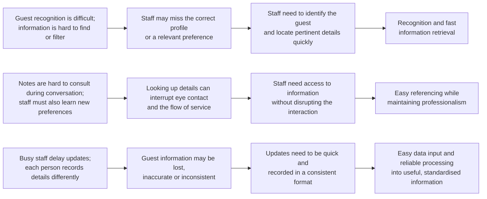

*Figure 1. Derivation of design needs from observed guest-information workflow gaps.*

Figure 1 sets out the reasoning behind these needs. Its intermediate links are the team's interpretation of the case-study workflow: recognition difficulties can lead to missed preferences; intrusive lookup can disrupt service; and delayed, inconsistent entry can weaken a shared profile. The figure is a design synthesis, not a claim that these consequences have been measured in every hotel. P&C Global's industry commentary similarly argues that the relevant differentiator is “data accessibility at the moment of service” ([P&C Global, n.d.](pandcglobal.com/research-insights/hyper-personalization-in-luxury-hospitality-the-new-standard/)). The team's synthesis also emphasises making information learned at that moment accessible for later service.

## First-time guests as a priority

The information gap is most visible when a guest has no established profile. Returning guests may have recorded preferences, rewards history, and rapport with staff; first-time guests have little of this context. Medallia found that guests with previous experience of a hotel brand were more likely to report a personalised stay than first-timers ([Medallia, 2024](medallia.com/wp-content/…/Medallia-Understanding-Personalization-Efforts-in-the-Hospitality-and-Retail-Industries-Report.pdf)).

The presentation attributes a single-digit first-time guest retention rate to the industry partner. The transcript does not specify its time period or definition, so it should be treated as a preliminary observation. The presentation frames a possible feedback loop: limited information constrains personalisation, which may reduce satisfaction and the likelihood of another visit. That loop is a working design hypothesis.

The immediate opportunity is to use the first stay to build a useful profile. A preference entered too late may not reach colleagues in time to improve the current stay. If it is captured early, associated with the correct guest, and shared promptly, another staff member may be able to use it during that same stay. This matters when service passes between staff members and shifts.

## Derived design needs and handoff

The analysis yields three design needs:

1. **Recognition and rapid retrieval:** Staff need to identify the correct guest and find information relevant to the immediate service task.
2. **Discreet referencing:** Staff need to use information while maintaining natural, professional engagement with the guest.
3. **Reliable capture and processing:** Staff need to record new preferences or concerns with little effort and make them accurate, consistent, and useful to colleagues.

Together, these needs describe a continuous information cycle: recognise the guest, act on existing knowledge, and share newly learned knowledge for the next interaction. They provide the basis for the following section's **capture-and-process** and **display** functions. The team's subsequent design criteria make these needs more specific: on-time service support addresses retrieval speed; glanceable interaction addresses unobtrusive use; and low-effort capture and preference continuity address timely, reliable updates across staff. Those criteria, rather than the present problem analysis, define what the prototype must be tested against.

## Design challenge

> **How might we enable luxury hotel staff to capture, share, and access relevant guest information seamlessly, so that they can deliver consistent, personalised, high-quality service?**

The mapped workflow, guest-journey analysis, and derived needs establish the problem to be addressed by the team's concept development and prototype evaluation. The intended value is a more usable flow of guest information during the first and subsequent stays; improvements in satisfaction or retention remain outcomes to investigate.

**Individual contribution:** [Insert your actual contribution to the case-study analysis, guest-journey synthesis, and design-need formulation.]

## References

- Hilton. (2022). [*Hilton spotlights travelers' changing expectations as a record year of travel concludes*](stories.hilton.com/releases/2023-travel-trends).
- Medallia. (2024). [*Understanding personalization efforts in the hospitality and retail industries*](medallia.com/wp-content/…/Medallia-Understanding-Personalization-Efforts-in-the-Hospitality-and-Retail-Industries-Report.pdf).
- P&C Global. (n.d.). [*Hyper-personalization in luxury hospitality: The new standard*](pandcglobal.com/research-insights/hyper-personalization-in-luxury-hospitality-the-new-standard).

<b>01 · Capture</b>A guest states a preference.<small>Emerging capability</small>

<b>02 · Check & share</b>Staff confirm the guest and meaning.<small>Planned approval workflow</small>

<b>03 · Retrieve</b>The next employee sees relevant context.<small>Demo profiles implemented</small>

<b>04 · Adapt</b>Staff make a suitable offer and confirm it.<small>Service benefit to evaluate</small>

## 2. Aim, scope, and requirements {#requirements}

The design question is:

> How might we enable luxury-hotel staff to capture, share, and access relevant guest information seamlessly, so they can deliver consistently personalised, high-quality service?

**First-time guest use case.** On an initial stay, staff may have little previous service history; the guest can still contribute booking, pre-arrival, or conversational information. The target is same-stay continuity, not an invented profile: capture an explicit preference during an early interaction, verify its guest and current-stay association, and make the confirmed detail available to the next employee when it fits the service task. A one-off comment must not automatically become an enduring preference. Semester 1 builds recognition, retrieval, and cue-display foundations for this handover, using a lounge encounter, demo gallery, fictional profiles, and manual activation. Production PMS integration, autonomous allergy decisions, and demonstrated service outcomes remain out of scope. [P1](#p1), [P3](#p3)

LQA anchors the requirements in timely, natural, discreet, attentive service. In the selected PARKROYAL F&B subset, staff should greet within one minute of lounge entry and offer to take a drinks order within three minutes of seating. These are staff-action windows, not cue-processing targets. The 15-item table is a departmental subset, not a complete audit or official LQA score; LQA is distinct from hotel star classification. [P8](#p8), [R4](#r4)

| Criterion | LQA service behaviour | Requirement and proposed measure |
|---|---|---|
| **DR1 · On-time service support** | Greet within 1 minute of entry; offer to take a drinks order within 3 minutes of seating. | Cue within **1.5 s at p95** from a defined trigger to first visible output; separately time entry/seating to the staff action. |
| **DR3 · Glanceable interaction** | Natural, friendly engagement; discreet name use. | Show a concise, relevant cue. Measure understanding, glance duration, attention shifts, and interruption. |
| **DR2 · Low-effort capture** | Active listening and natural engagement. | Start with one action. Measure capture time, staff actions, and conversation disruption. |
| **DR4 · Preference continuity** | Use confirmed preferences to personalise service. | Preserve source, time, scope, and review status; confirm guest and stay. Measure whether the approved preference reaches the next employee. |

**Cross-cutting safeguards.** DR5 suppresses personal cues for unknown, ambiguous, lost, or stale tracks. DR6 distinguishes preferences from allergies, minimises displayed fields, and keeps manual lookup available; allergy cues require an authoritative-record and food-safety check.

**Timing note.** The speaker script gives a **1.5-second** engineering target; this report specifies p95 for repeatable evaluation, not as an LQA requirement. The supplied slide still prints **<1 s** and should be reconciled before reuse. Four successful warm frame commits averaged 1.18 s but do not establish p95 or physical lens visibility. [P1](#p1), [P3](#p3), [P4](#p4)

## 3. Concept generation and selection {#concepts}

Concept comparison uses the same first-stay scenario: one guest shares a preference early in the stay and another employee needs it later. [P1](#p1)

| Criterion | Phone/PMS baseline | Audio badge + earpiece | Vision-assisted smart glasses |
|---|---|---|---|
| **Capture** | Staff looks up a profile and types a note; familiar, but screen use may interrupt and entry may be delayed. | Push-to-talk captures speech hands-free; noise and speaker attribution need testing. | Temple-triggered audio is hands-free; the camera adds visual context but also privacy and battery costs. |
| **Guest/stay link** | Staff explicitly selects guest and stay; slower, but visible and correctable. | Staff still selects guest/stay in a companion interface. | Vision proposes a match and may reduce lookup; uncertain matches must reveal no profile. |
| **Cue delivery** | A phone profile has detail but pulls attention away from the guest. | A short earpiece cue is hands-free and potentially private; audibility and comfort need testing. | A brief in-lens cue is glanceable but may distract or affect attention. |
| **Review and continuity** | Manual notes depend on timely entry and next-shift retrieval. | A transcript can become a draft, but staff must correct and confirm guest/stay before saving. | Could pair association with task-ranked cues and a reviewed update; extraction and writes are not integrated. |
| **Effort, privacy, fallback** | No new sensors, but profile navigation adds steps; phone lookup is the baseline. | No camera, but speech capture needs consent/retention review; phone lookup remains fallback. | Camera, mic, and display add privacy, comfort, battery, and integration constraints; suppress uncertain cues and use phone/PMS. |

Smart glasses remain the prototype direction because they could combine hands-free capture, visual association, and a cue in the service moment; the comparison does not establish a winner. A camera-free glasses variant could isolate display value from vision matching. Compare all concepts with the same guest information, task, and review support, measuring association errors, time to a useful cue, comprehension, interruption, privacy, and effort. The slide's table compares complete bundles; a formal morphological chart would first list alternatives for capture, association, processing, and output.

Existing products establish substantial prior capability. Oracle OPERA Cloud documents profiles containing preferences and images. hotelkit supports guest-request assignment, escalation, and follow-up. SoftServe has demonstrated wearable AR face identification, including VIP recognition. Consequently, face recognition on glasses and shared guest records are not themselves novel. [R5](#r5), [R6](#r6), [R7](#r7)

The project's contribution is the investigation of a combined same-stay service workflow: low-effort guest-context capture, checked association, and timely presentation of a relevant cue. Its lounge proposal additionally explores an **active lounge cohort** bounded by entry and exit. The implemented standalone glasses demo currently recognises against its loaded gallery rather than this card-derived cohort. That distinction defines an integration milestone. [P3](#p3), [P6](#p6)

## 4. System architecture and prototype development {#prototype}

### 4.1 Solution overview and staff journey {#initial-concept}

Chapter 3 selected smart glasses to combine guest recognition with information available during face-to-face service. From the employee's perspective, the concept is simple: look towards a guest, see their name and useful context, and use it to make an appropriate offer without searching a separate profile.

Figure 1 identifies the core technology. SQLite stores guest profiles and preferences; reference photos are stored separately. At startup, InsightFace `buffalo_l` detects and aligns reference faces, then ArcFace converts them into normalised 512-number vectors cached in RAM. A live face vector is compared with these references without reprocessing every photo. Initially, the camera would stay on continuously, capturing and analysing every frame. [P3](#p3)

<figure>
<a href="assets/initial-concept.svg" target="_blank" rel="noopener" aria-label="Open the initial smart-glasses concept diagram">
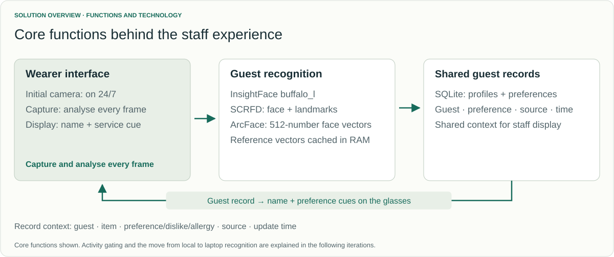
</a>
<figcaption><strong>Figure 1.</strong> Core functions, models, and guest-data setup, before examining the design iterations.</figcaption>
</figure>

**Proposed staff journey.** The first staff member taps the glasses to start. A stable, unique match can surface a relevant preference or allergy cue; without one, the system shows no personal details and staff greet normally, ask the guest, or use the phone/PMS. Staff confirms today's preference in conversation. An allergy cue prompts a check against the authorised guest record and menu or kitchen source before staff explains a risk or suggests an alternative. Afterward, the system can prepare a time-stamped draft grounded in the guest's words; staff edits it, confirms the guest/current stay, and approves it. The next employee can retrieve the approved detail when relevant. This end-to-end handover remains proposed.

<figure>
<a href="assets/staff-journey.svg" target="_blank" rel="noopener" aria-label="Open the intended staff service journey">
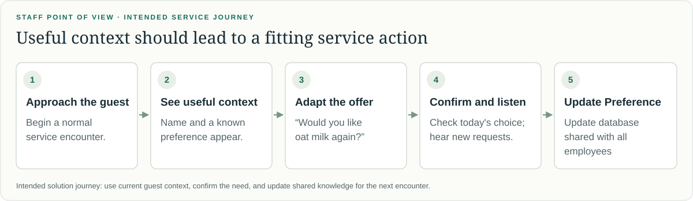
</a>
<figcaption><strong>Figure 2.</strong> Intended staff journey. The figure shows the normal service path; the text above adds no-match fallback, allergy verification, and the proposed reviewed handover.</figcaption>
</figure>

The present glasses demo covers manual activation, recognition against a loaded gallery, prepared-profile retrieval, and cue rendering. Audio capture, confirmed guest/stay association, staff-approved profile writes, next-shift retrieval, and task-ranked cue selection remain to be integrated; Chapter 5 assesses the demonstrated path.

### 4.2 Capture {#capture}

Capture iterations use measurable tests: battery depletion, traffic, silence-timeout duration, latency, and guest facts matched against expected answers. The intended path stores an explicit, time-stamped statement as a sourced draft, associates it with a likely guest/stay, and tracks scope and review status. Staff approval is required before the shared record is updated. Display ranks checked context by location, task, urgency, and validity. Text extraction is explored separately; audio capture and reviewed updates are not integrated.

<figure>
<a href="assets/capture-pipeline.svg" target="_blank" rel="noopener">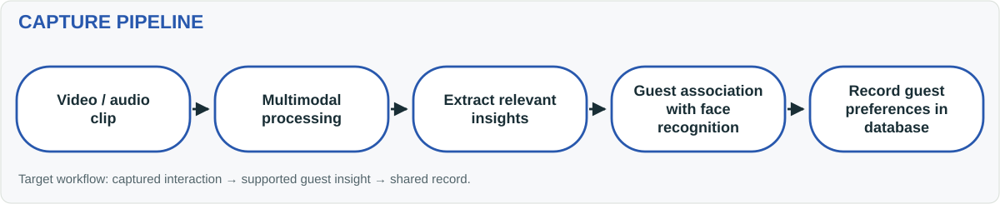</a>
<figcaption><strong>Figure 3.</strong> Intended capture workflow, before refining activation and processing allocation.</figcaption>
</figure>

#### 4.2.1 Temple-touch activation {#activation}

Continuous capture requires less staff input but keeps processing active between encounters. Reported battery life was only slightly over an hour, insufficient for a hotel shift. Temple-touch activation trades a single tap for longer battery life. [P1](#p1)

The timeout balances battery use with **DR2, low effort**: one tap starts capture, speech sustains it, and 15 seconds without speech ends it automatically, without repeated taps or a separate stop action. Expiry stops camera/microphone activity, cancels requests, and clears cues. Speech cannot activate idle capture. [P3](#p3)

<figure>
<a href="assets/activation-iteration.svg" target="_blank" rel="noopener">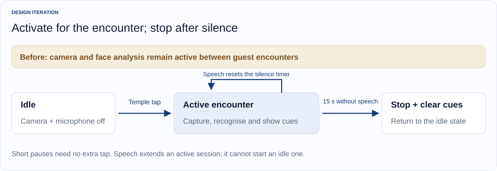</a>
<figcaption><strong>Figure 4.</strong> Encounter activation and speech-controlled session expiry.</figcaption>
</figure>

Local WebRTC voice activity detection distinguishes speech-like activity from silence. The timeout was tested and verified at approximately **15.4 seconds in a quiet-room setting**; restaurant and front-desk conditions still need verification. [P3](#p3)

The 20-minute battery experiment used a one-minute conversation every five minutes. Including the 15-second silence period gives 75/300 seconds of scheduled activity, or 25%. [P1](#p1), [P7](#p7)

| Activation comparison | Continuous | Temple touch + silence timeout |
|---|---:|---:|
| Scheduled duty cycle | 100% | 25% |
| Reported traffic count | 705 | 170 |
| Battery-level drop | 28 percentage points | 9 percentage points |

Traffic fell by 75.9%; battery depletion fell by 19 percentage points, approximately 68% relative depletion. This measures battery-gauge change, not electrical power. [P1](#p1), [P7](#p7)

#### 4.2.2 Selective server processing {#processing}

Local photo recognition alone averaged **1,927.9 ms**, numerically longer than the **1.5 s end-to-end cue objective**. This component mean comes from a separate benchmark, so it is a bottleneck signal rather than a direct p95 compliance result; camera, transfer, and display add further stages. SCRFD preparation/inference/postprocessing took **1,268.7 ms**, and alignment, ArcFace inference, and matching **639.1 ms**, versus **20.1 ms** for JPEG decoding. Recognition dominated, motivating selective offloading. [P5](#p5)

Camera handling, tracking, crop preparation, and rendering remain local; the laptop handles InsightFace `buffalo_l` recognition and lookup. Planned extraction also belongs there. This targets **DR1**, keeping position updates responsive. A separate battery benefit remains unmeasured. [P3](#p3)

<figure>
<a href="assets/capture-offload-pipeline.svg" target="_blank" rel="noopener">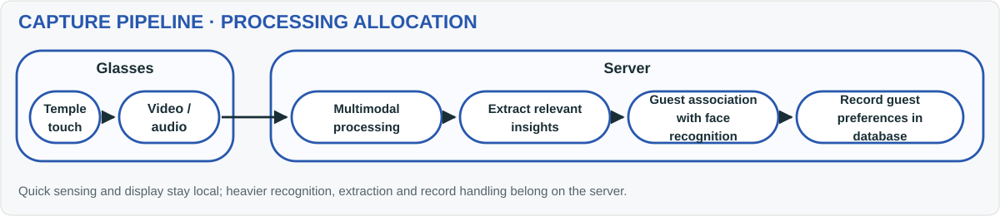</a>
<figcaption><strong>Figure 5.</strong> Selective server allocation. Recognition is implemented; automatic preference extraction and updates remain planned.</figcaption>
</figure>

The comparison used 15 warm probes per mode, the same enrolled 800 × 800 photo, five gallery identities, CPU execution, and 0.50/0.10 score/margin settings. Offline testing disabled Wi-Fi and stopped the laptop server. [P5](#p5)

| Warm photo-recognition path | Mean | Median | Observed range |
|---|---:|---:|---:|
| Glasses → Wi-Fi → laptop → parsed response | 1,350.6 ms | 1,311.6 ms | 1,220.1–1,513.7 ms |
| Entire recognition on glasses | 1,927.9 ms | 1,896.0 ms | 1,848.6–2,379.7 ms |

<figure class="chart">

Recognition offloading: approximately 30% lower elapsed time

15 warm photo probes per mode · camera, enrolment and display excluded

Laptop via Wi-Fi

1,350.6 ms

On glasses

1,927.9 ms

01,2002,400 ms

<figcaption><strong>Figure 6.</strong> Elapsed time decreased 29.9%. Self-reference probes establish neither recognition accuracy nor complete touch-to-cue performance.</figcaption>
</figure>

The offloaded mean of **1,350.6 ms** is close to the 1.5-second objective, but this warm photo benchmark excludes camera, image preparation, and display, so it cannot show whether the complete-path p95 is met. Only one CPU laptop was tested; a more powerful server or accelerated inference could help. Gains require measurement alongside image-preparation and scheduling optimisation, then complete-path retesting (Section 5.2). [P5](#p5)

#### 4.2.3 Independent preference-extraction testing {#preference-extraction}

For **DR4, preference continuity**, extraction is tested separately to check accuracy before glasses integration. Current tests use written transcripts; audio transcription is not connected. [P13](#p13)

Three local models processed two invented, speaker-labelled conversations containing three expected guest facts. Outputs use a fixed data format (JSON) for category, value, and guest quote; automated checks compare these with the guest's words. Results remain drafts without guest-record changes. The M1 Mac results compare fact matches and runtime. [P1](#p1), [P13](#p13)

| Reported local model | Correct JSON format | Guest facts matched | Mean time/transcript |
|---|---:|---:|---:|
| `llama3.2:3b` | 2/2 | 1/3 | 76.1 s |
| `qwen3:4b-instruct` | 2/2 | 2/3 | 67.2 s |
| `gemma4:e2b` | 2/2 | 2/3 | 86.4 s |

**Qwen is the provisional best model:** it tied Gemma at 2/3 facts and was fastest at 67.2 seconds. This small test cannot establish general accuracy; timing covers extraction only. [P1](#p1), [P13](#p13)

Gemma treated “too sweet” as a preference and a dessert-safety question as dietary information, despite correct formatting. Further tests must distinguish complaints/questions from preferences, check corrections and negative statements, assign facts to the correct speaker, and repeat inputs to assess consistency. [P13](#p13)

After improving text-only extraction, compare it with added video of the same interactions. Measure whether visual information adds enough correct detail to justify the extra processing. Audio transcription should be evaluated separately.

### 4.3 Display {#display}

Display testing uses user feedback on placement, readability, and relevance. The pipeline identifies the guest, retrieves their record, and returns cues.

<figure>
<a href="assets/display-pipeline.svg" target="_blank" rel="noopener">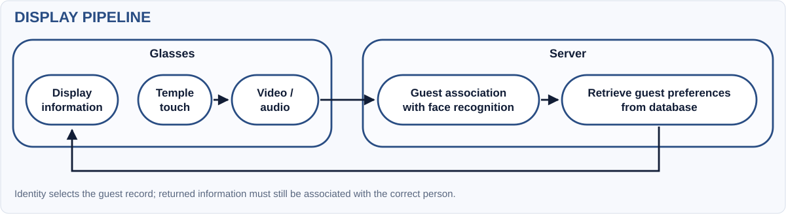</a>
<figcaption><strong>Figure 7.</strong> Identity-to-record-to-display flow; the placement iteration adds local position updates.</figcaption>
</figure>

#### 4.3.1 Positioning information beside the guest {#display-position}

Initially, cues occupied a fixed display position. User feedback and prototype validation prompted face-relative placement and central guest selection, aiming to reduce looking away from the guest and competing details from several visible faces. These iterations address **DR3, glanceability**. [P1](#p1), [P7](#p7)

Google **ML Kit**, an on-device machine-learning toolkit, detects faces and tracks positions locally; InsightFace identifies the guest. The central **30% of both view axes** defines the selection region, choosing the face nearest its centre. This aims to show preferences for the guest receiving the employee's attention, avoiding details for everyone visible. Selection uses where the glasses point; it does not measure eye contact. [P3](#p3), [R11](#r11)

Face coordinates also allow cropping before image preparation, removing a 2.2–2.4-second full-frame preparation delay. In an earlier SFace-model test, 14 uploads averaged 200 ms from image-analysis callback to server response. This supports the cropping change for **DR1**; the timing excludes tap handling and display and is separate from the current-model benchmark. [P3](#p3)

<figure>

Before · fixed position
<a href="assets/ui/01-position-before.png" target="_blank" rel="noopener">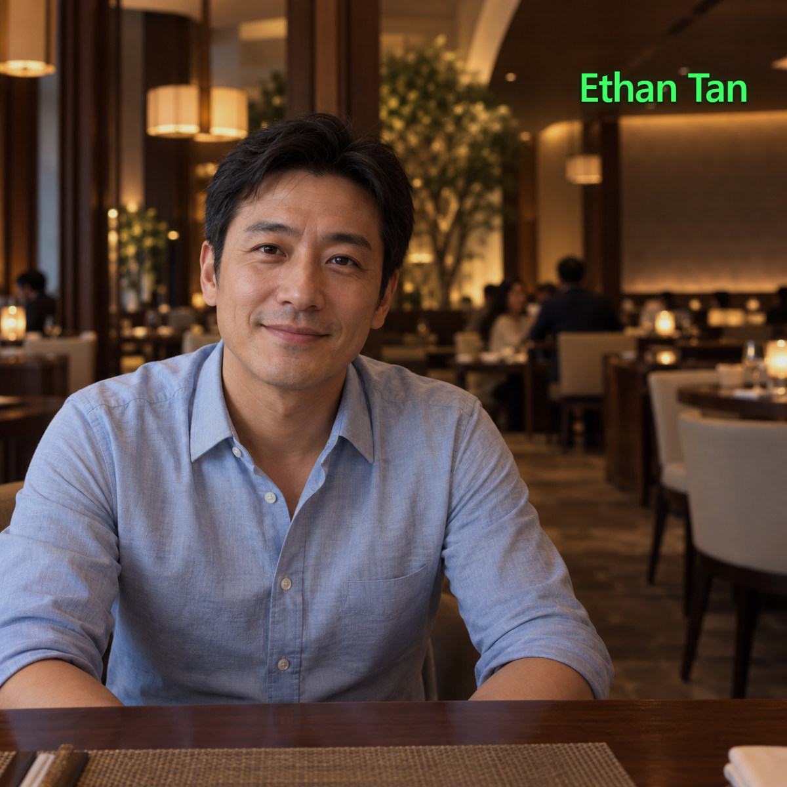</a>

After · beside the face

<figcaption><strong>Figure 8.</strong> Generated UI comparison: local tracking brings the cue beside the guest; eye contact is unmeasured. <a href="#p12">P12</a></figcaption>
</figure>

#### 4.3.2 Replacing descriptions with concise icons {#display-content}

Even beside the guest's face, long descriptions require staff to read while listening. To support **DR3**, the display instead shows a name and up to two icons. **DR6** requires preferences and allergy alerts to remain distinguishable. [P1](#p1)

<figure>

Before · written description
<a href="assets/ui/03-content-before.png" target="_blank" rel="noopener">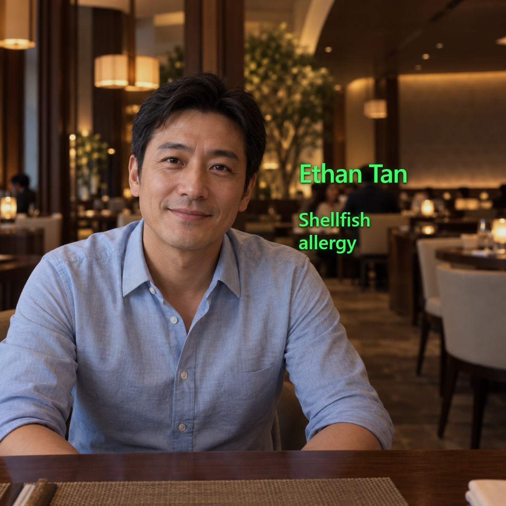</a>

After · compact icon

<figcaption><strong>Figure 9.</strong> Generated UI comparison: text becomes an item-and-warning icon. The allergy is a fictional demo cue. <a href="#p12">P12</a></figcaption>
</figure>

The main icon shows an item, such as coffee; its corner marker means preference (heart), dislike (crossed-out heart), or allergy alert (warning triangle). Icons appear beneath the name and are stored on the glasses, avoiding extra downloads. [P3](#p3)

<figure>
<a href="assets/icon-reference.svg" target="_blank" rel="noopener">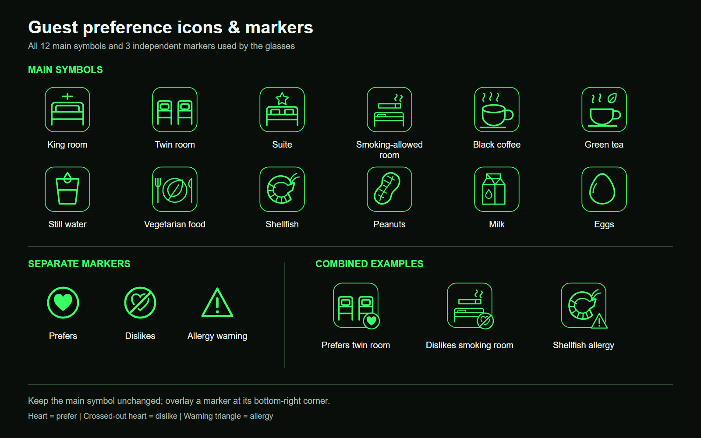</a>
<figcaption><strong>Figure 10.</strong> All 12 supported item icons and three independent markers, with combined examples. Allergy assignments are fictional. <a href="#p3">P3</a></figcaption>
</figure>

The prototype shows at most two icons, puts allergy alerts first, and hides personal details when a guest is unrecognised or the face association is lost. Automated checks verify placement and that names and icons disappear together. [P11](#p11)

Concise information follows display guidance, but short symbols can still distract. User testing must check whether people understand the icons without coaching and use them without interrupting conversation. [R8](#r8), [R9](#r9)

#### 4.3.3 Retrieving contextually relevant preferences {#contextual-retrieval}

The next proposed iteration selects information to fit the moment. Face recognition determines **whose record** to retrieve; conversation and service context determine **which details** to show. Location, task, urgency, and validity could rank the candidates: during breakfast, for example, a checked drink preference should take precedence over an unrelated room arrangement.

<figure>
<a href="assets/context-pipeline.svg" target="_blank" rel="noopener">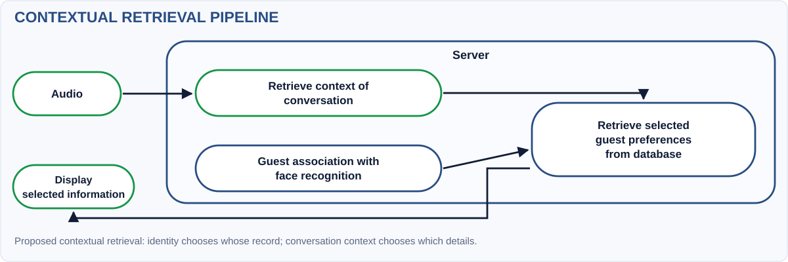</a>
<figcaption><strong>Figure 11.</strong> Proposed contextual retrieval, combining identity and conversation context.</figcaption>
</figure>

This addresses **DR3 and DR6**: an easily understood room icon can still be unhelpful during a drinks order. The proposed filter would select relevant, checked preferences from the shared record (DR4), while retaining priority for allergy alerts under the hotel's verification rules. [P1](#p1)

<figure>

Before · unrelated room preferences
<a href="assets/ui/05-context-before-extra-room-icons.png" target="_blank" rel="noopener">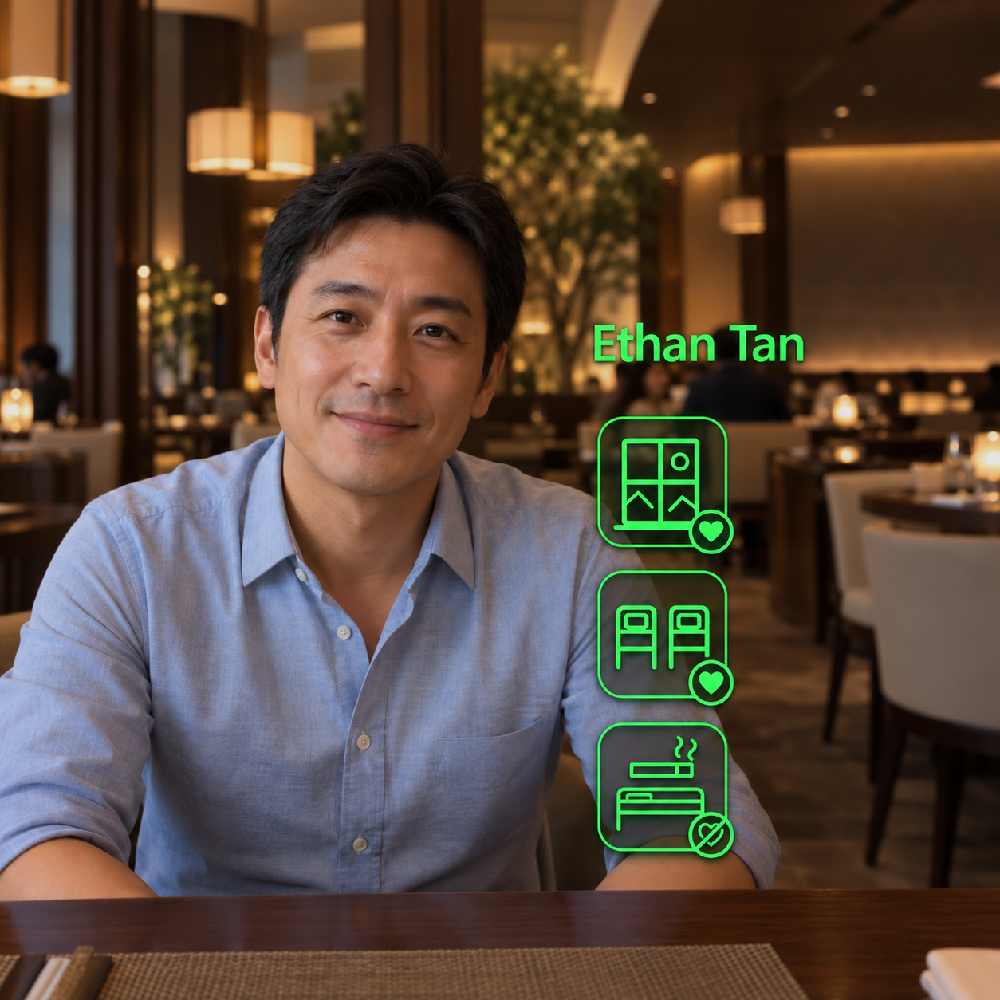</a>

Proposed after · relevant drink preference
<a href="assets/ui/06-context-after.png" target="_blank" rel="noopener">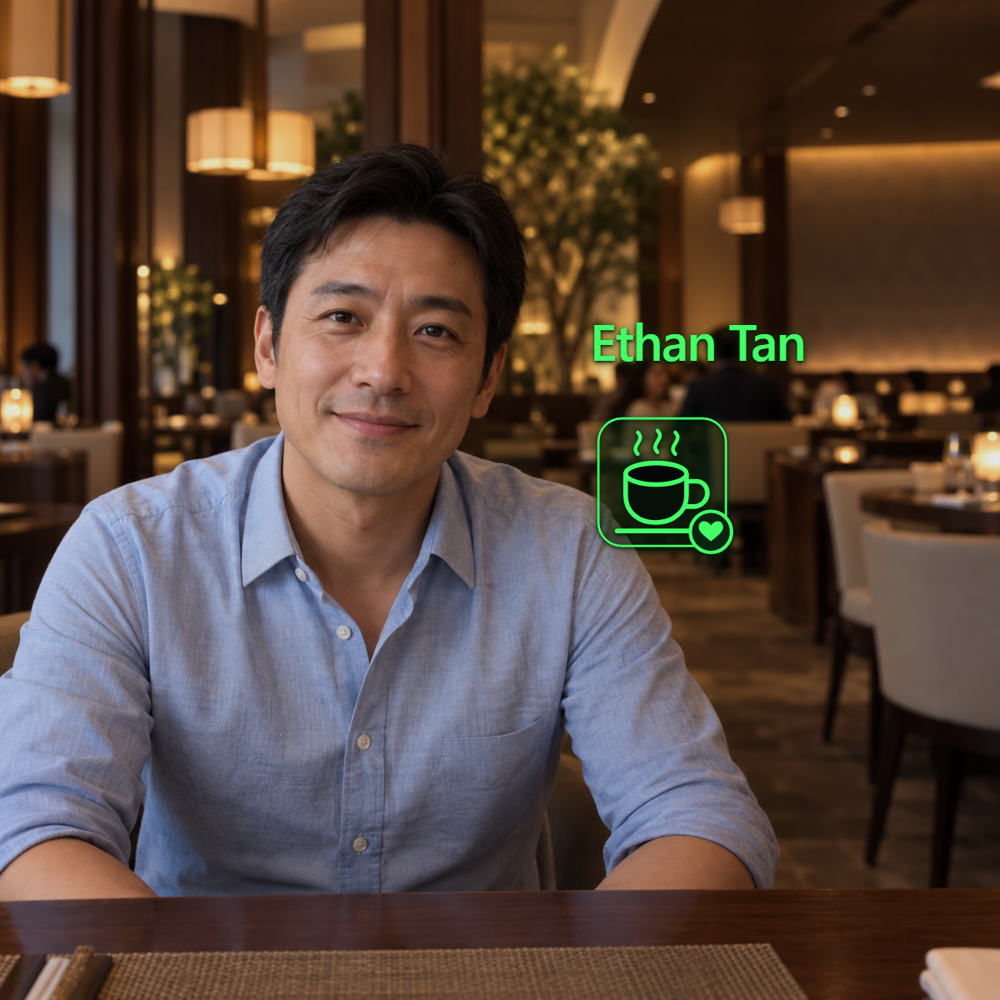</a>

<figcaption><strong>Figure 12.</strong> Generated UI comparison illustrating the proposed relevance filter; it is not evidence of implemented conversation understanding. <a href="#p12">P12</a></figcaption>
</figure>

**Current status.** The prototype shows up to two stored reminders, with allergy alerts first. It does not yet interpret conversations to select preferences; microphone activity only controls how long the session runs. [P3](#p3)

Testing should compare the same scenarios with and without filtering: does the system identify the topic correctly, show useful information, or hide something staff need? This tests relevance as well as readability.

### 4.4 Complete system architecture {#system-architecture}

Figure 13 combines the iterations in the **Rokid RV101 → Wi-Fi/HTTP → laptop → display** architecture. Solid paths describe current functions; the dashed extension is planned. [P10](#p10)

<figure>
<a href="assets/system-architecture.svg" target="_blank" rel="noopener" aria-label="Open the full system architecture as a scalable diagram">
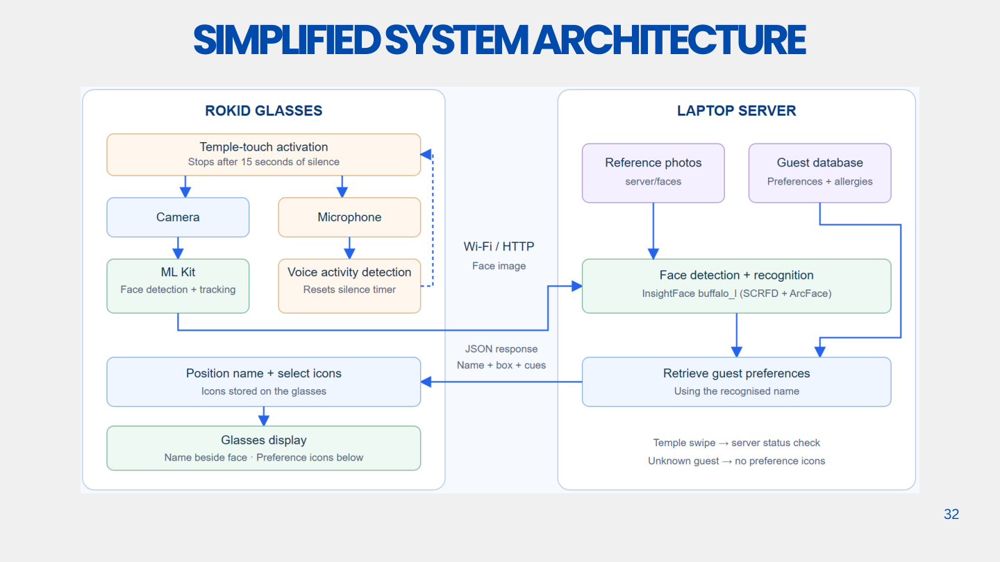
</a>
<figcaption><strong>Figure 13.</strong> Full implemented architecture and proposed audio-preference extension. <a href="assets/system-architecture.svg" target="_blank" rel="noopener">Open the scalable diagram ↗</a> or <a href="assets/system-architecture.png" target="_blank" rel="noopener">view the full-resolution PNG ↗</a>. Source: <a href="#p10">P10</a>.</figcaption>
</figure>

**Communication.** The glasses send one recognition request at a time to avoid a queue of old images. Late results are ignored so outdated details are not displayed. A swipe checks the server connection. [P3](#p3)

**Recognition.** The server compares faces with stored references. A match needs at least 0.45 similarity and must beat the next candidate by 0.10. Lowering the minimum from 0.50 reduced unrecognised results but may admit wrong matches. These scores measure similarity, not confidence percentages. [P3](#p3), [P11](#p11)

**Shared records.** The server loads guest profiles into memory at startup. This speeds lookup, but database edits require a restart before displayed information changes. DR4 therefore still needs reliable updates reaching another employee. Unique guest IDs should replace name-based lookup to distinguish guests with the same name. Incoming camera images are not saved; unrecognised guests receive no personal details.

The dashed extension would add audio upload, local Whisper transcription, Gemini extraction, and staff-reviewed database updates. These are not connected to the glasses workflow yet. The separate card-entry prototype is also not integrated. [P6](#p6), [P10](#p10)

## 5. User validation and system evaluation {#testing}

### 5.1 User validation {#user-validation}

The team conducted a walkthrough and product testing with **10 non-hotel participants**, examining activation, potential usefulness, and cue use. This formative work supports problem finding and prototyping, rather than proving improved hotel service. [P1](#p1)

| Walkthrough question | Reported finding | Design implication |
|---|---|---|
| Is starting capture/display easy? | All 10 described activation as easy. | Retain single-tap activation; test it during realistic staff tasks. |
| Could cues help serve guests? | 70% saw potential usefulness, but some icons were unrelated to the conversation. | Develop contextual retrieval and assess whether it enables a specific service action. |
| Can cues be used naturally? | Most described a quick glance as sufficient, but incorporating cues into conversation was challenging. | Test timing, meaning, and conversational flow together; investigate design changes as well as training. |

Understanding an icon and using it in conversation are different tasks. A participant may recognise a coffee preference but be unsure when to mention it. The feedback connects shorter icons (Section 4.3.2) with relevant selection (Section 4.3.3): staff need information that fits the current interaction.

This small non-staff study identifies improvements for the next prototype. It did not compare ordinary profile lookup or measure gaze and attention, so it cannot establish improved hotel service or reduced distraction.

### 5.2 Design requirements and whole-system testing {#requirements-check}

System testing covers **tap → select guest → recognise face → retrieve stored profile → display information**. The further step—turning a conversation into an approved update that helps another employee—remains incomplete. The assessment combines measured results, implementation checks, and user feedback against Chapter 2's requirements.

On 3 November, 13 live activations included quick repeat taps while capture was already running. Five produced a recognised name and icons in the app's drawing process; four also recorded an Android frame commit, confirming a completed frame was submitted for display. These four averaged **1,180 ms**, median **1,198.5 ms**, range **974–1,349 ms**. [P4](#p4)

| Measured stage, four completed frames | Mean |
|---|---:|
| Tap handled → selected image sent: camera, face selection, image preparation, scheduling | 693 ms |
| Request sent → server response read, including recognition | 302 ms |
| Response read → app draws name and icons | 101.3 ms |
| Drawing → Android confirms frame submitted | 83.8 ms |
| Total | **1,180 ms** |

Server recognition took 177.5 ms within the 302 ms request stage; it is not an additional delay. The largest delay was before sending the image, so optimisation must address capture and selection as well as server speed. Another activation took 4,412 ms to draw information without a completed frame recorded before the next tap; eight had no accepted name/icon output before another tap. Repeat taps can interrupt processing, so these counts do not establish a success rate. Independent starts from idle and physical on-lens timing still need testing.

| Requirement | Current evidence | Assessment and next verification |
|---|---|---|
| **DR1 · On-time support:** 1.5 s p95 cue objective | Four successful warm commits averaged 1.18 s; this does not estimate p95, include cold starts, or include every interrupted attempt. | **Not enough evidence to assess p95.** Repeat independent cold/warm trials and count all failures. |
| **DR2 · Low effort:** single tap and automatic silence expiry | All 10 participants found activation easy; checks verify timeout and camera/microphone shutdown. | **Early support.** Test staff task interference and stopping behaviour in realistic noise. |
| **DR3 · Glanceability:** concise cues during conversation | Icons are implemented; 70% reported needing only a quick glance, but natural conversational use remained difficult. | **Partially achieved.** Compare comprehension, attention shifts, and conversational flow with a baseline. |
| **DR4 · Preference continuity:** approved update reaches another employee | Stored profiles are retrieved; new facts are not consistently extracted and profile changes require restart. | **Incomplete.** Test captured statement → review → updated record → next employee's action. |
| **DR5 · Correct association:** hide uncertain/outdated details | Tests check unrecognised guests, tracking changes, expired results, and cancellation. | **Safeguards implemented; real-world error rates unknown.** Count wrong guest details and missed matches in new, crowded test scenes. |
| **DR6 · Appropriate information:** relevant fields and distinct allergy handling | Two-cue limit and fictional allergy markers exist; irrelevant content was reported. | **Partially achieved in demo data.** Validate contextual selection, interpretation, permissions, and fallback. |

Retrieval and display work; the service benefit and complete handover still need evaluation. The photo benchmark and four live frame measurements cover different stages and must be reported separately.

### 5.3 Limitations and guest acceptance {#guest-acceptance}

A separate exploratory survey asked how comfortable respondents would be with hotels noting and storing preferences for better service. Ratings 4 and 5 account for 31.3% and 9.4%, giving **40.7% rating 4 or 5**. Responses therefore do not establish majority acceptance. The recruitment method and denominator are not supplied, so this is exploratory feedback rather than a representative guest estimate. [P1](#p1)

Preference-storage comfort also does not establish acceptance of facial images, purchase-history processing, or recorded conversations. The next study should distinguish those activities, explain purpose and access, and allow guests to express different choices. A lounge access tap alone does not demonstrate permission for every proposed use. The PDPA and PDPC biometric guidance are reference points for review with the hotel and university; the latter concerns security applications rather than approving this hospitality workflow. [R10](#r10)

The implemented microphone currently detects activity locally, whereas the planned extension would introduce audio/transcript handling and an external model service. That change needs its own participant and data protocol. Face thresholds and track guards reduce particular failure paths but have not been evaluated for representative error rates. Fictional allergy icons likewise test presentation, not food safety. These limits define the next-stage study boundary; they do not negate the present prototype's value for discovering usability and integration problems.

### 5.4 Next development and validation steps {#next-development}

The next phase will improve extraction and relevance, compare the complete handover with ordinary profile lookup using hotel staff, and keep any LQA-related output evidence-linked and human-reviewed. Chapter 6 gives the phased work plan; Appendix B specifies the comparison protocol. [P8](#p8)

## 6. Limitations, responsible use, and next-stage plan {#next-stage}

The strongest interim outcome is a tangible recognition-and-display prototype supported by component measurements and formative feedback. The complete capture → approved update → another employee's relevant service action has not yet been validated. Several implementation and study boundaries determine the next phase.

**Data, identity, and safety.** Recognition thresholds are not guarantees; suppress cues for uncertain matches. Save a new preference only after staff confirms its supporting words, guest/stay, scope, and validity. Allergy information must be checked against the authorised record and food-safety source; fictional icons are not evidence of safety.

**Guest and employee control.** Before real-person testing, obtain hotel and university review of purpose, notice and consent or other approved basis, access, correction, and retention. A lounge tap or preference survey does not itself authorise face or audio capture. [R10](#r10), [P2](#p2)

**LQA use.** Keep outputs as evidence-linked suggestions for human review. The selected subset is not an overall grade or staff ranking. [P8](#p8)

The following is a proposed sequence for Semester 2, with weeks relative to its start; it is a work plan rather than a confirmed hotel booking.

| Window | Work package and deliverable | Decision or evidence required |
|---|---|---|
| Weeks 1–2 | Confirm one lounge service moment, staff roles, existing profile path, data permissions, and cue categories with the partner. | Agreed workflow map, baseline task, and participant/data protocol. |
| Weeks 2–4 | Build an extraction evaluation set with explicit preferences, questions, complaints, corrections, multiple speakers, and visual-only observations. | Versioned prompts/models; human-labelled facts; precision, recall, unsupported claims, and attribution errors. |
| Weeks 3–5 | Implement staff review/correction before profile writes and contextual retrieval for one F&B task. | Approved update reaches a second employee; irrelevant and superseded cues are withheld. |
| Weeks 4–6 | Test recognition on held-out images, ambiguous guests, track changes, and network failure; repeat independent cold/warm timing and longer battery trials. | Report every activation and failure, p50/p95 where supported, false reveals, starting charge, duration, and complete traces. |
| Weeks 6–8 | Run an approved formative pilot with approximately 6–8 hotel staff, subject to access, using counterbalanced phone and glasses tasks. | Correct guest/action, cue comprehension, task time, attention shifts, guest-perceived fit in staged encounters, and qualitative feedback. |
| Weeks 9–10 | Refine the most consequential failures; demonstrate the complete same-stay handover and report the comparison. | A traceable requirements check and a supported decision about continuing with the wearable. |

Proposed acceptance gates are zero observed wrong-profile reveals in the defined test set, source-supported approved preferences, reliable no-match fallback, and improved task performance without poorer comprehension or conversational flow. Zero observed errors would remain a bounded sample result. Final numerical targets and sample sizes should be agreed before testing. Deployment cost should subsequently include hardware, server/network resources, integration, charging, maintenance, and training; the current evidence is insufficient for a credible ROI estimate.

## 7. Team contributions {#contributions}

The team confirmed the following division, following the presentation split. This records the main areas of work without assigning undocumented individual ownership of particular experiments. [P7](#p7)

| Team member | Main area of contribution |
|---|---|
| Neha Rajan | Problem investigation and framing; hotel/business context, service quality, and the rationale for personalisation. |
| Nigel Yeo Tong Wei | Problem investigation and framing; current guest-information practices, first-time guest needs, and the design challenge. |
| Wong Weng Hong | Solution development; functional requirements, concept comparison, and the proposed staff/guest journey. |
| Tan Ping Hui | Solution development; technical implementation, prototype iterations, testing, and the next development steps. |

The interim contribution is an implemented service-support mechanism and a clearer account of what must be tested next. Whether the mechanism improves hotel service remains the central evaluation question for the next stage.

## References and project evidence {#references}

<strong>R1.</strong> Lei, S. S. I., Wang, D., Fong, L. H. N., & Ye, S. (2024). “Recipe for perceived personalization in hotels.” <em>Tourism Management, 100</em>, 104818. <a href="https://research.polyu.edu.hk/en/publications/recipe-for-perceived-personalization-in-hotels/">Institutional publication record and abstract</a> · <a href="https://doi.org/10.1016/j.tourman.2023.104818">DOI</a>.

<strong>R2.</strong> Medallia Market Research (2024). <em>Understanding Personalization Efforts in the Hospitality and Retail Industries.</em> <a href="https://www.medallia.com/wp-content/uploads/pdf/resources/Medallia-Understanding-Personalization-Efforts-in-the-Hospitality-and-Retail-Industries-Report.pdf">Original report</a>. Vendor-produced U.S. guest survey.

<strong>R3.</strong> Piccoli, G., Lui, T.-W., & Grün, B. (2017). “The impact of IT-enabled customer service systems on service personalization, customer service perceptions, and hotel performance.” <em>Tourism Management, 59</em>, 349–362. <a href="https://dds.cct.lsu.edu/ddslab/pdf/piccoliLuiGruen.pdf">Author-hosted article</a> · <a href="https://doi.org/10.1016/j.tourman.2016.08.015">DOI</a>.

<strong>R4.</strong> LQA. <a href="https://lqagroup.com/hotel-assessments/">Hotel assessments</a>. Public description of its quality-assessment framework; accessed 10 November 2026.

<strong>R5.</strong> Oracle. <a href="https://docs.oracle.com/en/industries/hospitality/opera-cloud/25.4/ocsuh/ch_profiles_intro.htm">OPERA Cloud 25.4: Profiles</a>. Official product documentation; accessed 10 November 2026.

<strong>R6.</strong> hotelkit. <a href="https://hotelkit.net/solutions/guest-services/">Guest services</a>. Vendor-described request assignment and complaint follow-up; accessed 10 November 2026.

<strong>R7.</strong> SoftServe. <a href="https://www.softserveinc.com/en-us/resources/hands-free-face-id-demo">Hands-Free Face ID</a>. Public AR identification demonstration; accessed 10 November 2026.

<strong>R8.</strong> Google. <a href="https://developer.android.com/design/ui/ai-glasses/guides/foundations/design-principles">AI Glasses design principles</a>. Official design guidance; accessed 10 November 2026.

<strong>R9.</strong> Lewis, J. E., & Neider, M. B. (2016). “Through the Google Glass: The impact of heads-up displays on visual attention.” <em>Cognitive Research: Principles and Implications, 1</em>, 13. <a href="https://doi.org/10.1186/s41235-016-0015-6">Open-access article</a>.

<strong>R10.</strong> Personal Data Protection Commission Singapore (2022). <a href="https://www.pdpc.gov.sg/-/media/files/pdpc/pdf-files/other-guides/guide-to-biometric_17may2022.pdf">Guide on Responsible Use of Biometric Data in Security Applications</a>. Scope: security applications. See also <a href="https://sso.agc.gov.sg/Act/PDPA2012">Personal Data Protection Act 2012</a>, Singapore Statutes Online.

<strong>R11.</strong> Google. <a href="https://developers.google.com/ml-kit/vision/face-detection">Face detection documentation</a>. On-device detection and tracking, distinct from identity recognition; accessed 10 November 2026.

<strong>P1.</strong> Team IS-432 (5 November 2026). <a href="Slides.pdf">Interim presentation, 37 slides</a>; <a href="Recording.mp4">presentation recording, 29 min 18 s</a>; <a href="transcript.html">timestamped transcript</a>. Slide numbers in this report refer to the supplied PDF.

<strong>P2.</strong> Project field records: <a href="https://github.com/wongwh2002/CDE4301-Hotel-Hospitality/blob/main/hotel-visit/novotel-formatted.md">Novotel formatted visit notes</a>; <a href="https://github.com/wongwh2002/CDE4301-Hotel-Hospitality/blob/main/hotel-visit/parkroyal-main-points.md">PARKROYAL visit summary</a>; <a href="https://github.com/wongwh2002/CDE4301-Hotel-Hospitality/blob/main/hotel-visit/raw-notes/parkroyal-oct-visit-transcript.md">later PARKROYAL discussion transcript and source caveats</a>. These records have different evidence quality; formatted field notes are paraphrases.

<strong>P3.</strong> <a href="https://github.com/wongwh2002/CDE4301-Hotel-Hospitality/blob/main/rokid/README.md">Rokid prototype implementation and validation notes</a>; <a href="https://github.com/wongwh2002/CDE4301-Hotel-Hospitality/tree/main/rokid/app/src/main/java/com/example/rokid_app">Android implementation</a>; <a href="https://github.com/wongwh2002/CDE4301-Hotel-Hospitality/blob/main/rokid/server/GUEST_PREFERENCES.md">demo guest cue schema and rendering</a>.

<strong>P4.</strong> <a href="https://github.com/wongwh2002/CDE4301-Hotel-Hospitality/blob/main/rokid/DISPLAY_LATENCY_BENCHMARK.md">Temple touch to displayed information</a>, live RV101 series, 3 November 2026. This is the source for the four frame-commit observations and their timing boundaries.

<strong>P5.</strong> <a href="https://github.com/wongwh2002/CDE4301-Hotel-Hospitality/blob/main/rokid/LATENCY_BENCHMARK.md">Server versus on-device photo-recognition benchmark</a> and <a href="https://github.com/wongwh2002/CDE4301-Hotel-Hospitality/blob/main/rokid/RETRIEVAL_MODE_BENCHMARK.md">retrieval-mode and battery replay comparisons</a>, 2 November 2026.

<strong>P6.</strong> <a href="https://github.com/wongwh2002/CDE4301-Hotel-Hospitality/blob/main/README.md">Local POC scaffold</a>; <a href="../architecture/hotel-lounge-smart-glasses-poc.html">interactive proposed architecture</a>; <a href="https://github.com/wongwh2002/CDE4301-Hotel-Hospitality/blob/main/docs/agents/hotel-smart-glasses-poc.md">project framing</a>. Architecture status remains proposed.

<strong>P7.</strong> Team clarifications, 10–11 November 2026: the 20-minute battery test was verified; no local raw file is available. Neha/Nigel mainly addressed the problem; Weng Hong/Ping Hui the solution. Battery life motivated temple touch; user feedback/validation preceded face-relative placement and central selection.

<strong>P8.</strong> <a href="../research/source-materials/PARKROYAL-COLLECTION-2026-FB-LQA-15-Selected.csv">Current selected 15-item F&B table</a> · <a href="../research/source-materials/PARKROYAL-COLLECTION-2026-FB-LQA-15-Selected.pdf">PDF preview</a> · <a href="https://github.com/wongwh2002/CDE4301-Hotel-Hospitality/blob/main/docs/research/fb-conversation-checker-prototype-subset.md">checker evidence and evaluation guidance</a>. The current table supersedes earlier candidate-list numbering.

<strong>P9.</strong> CDE4301 <a href="../rubrics/CDE4301%20assessment%20brief%20and%20rubrics%20-%20AY2026%20-%20interim%20assessment.pdf">interim assessment brief and rubric</a>. Four-person group: 6,000-word limit excluding appendices; individual areas of work must be identified.

<strong>P10.</strong> <a href="assets/system-architecture.png">Full Rokid system architecture</a> · <a href="assets/system-architecture.svg">scalable SVG</a>. Adapted from <code>rokid/output/architecture/rokid-system-architecture.svg</code>: local detector label generalised; architecture unchanged. The dashed audio-preference extension remains planned.

<strong>P11.</strong> Implementation-level checks: <a href="https://github.com/wongwh2002/CDE4301-Hotel-Hospitality/tree/main/rokid/app/src/test/java/com/example/rokid_app">Android unit tests for session, focus, tracking, and image buffers</a>; <a href="https://github.com/wongwh2002/CDE4301-Hotel-Hospitality/tree/main/rokid/app/src/androidTest/java/com/example/rokid_app">device tests for microphone/VAD, request deadlines, and cue rendering</a>; <a href="https://github.com/wongwh2002/CDE4301-Hotel-Hospitality/tree/main/rokid/server">server recognition, API, and guest-cue tests</a>. Test presence describes verification coverage; recorded execution results are attributed to P3.

<strong>P12.</strong> <a href="https://github.com/wongwh2002/CDE4301-Hotel-Hospitality/tree/main/rokid/output/slide-20-ui/screenshots">Generated prototype UI illustrations</a>, reproduced unchanged: position, content, and context before/after pairs. Pipeline diagrams redraw the supplied presentation's flows; contextual filtering remains proposed.

<strong>P13.</strong> Team-supplied “Note worker testing” summary, provided 11 November 2026. <a href="evidence/preference-extraction-test-summary.md">Transcribed method and reported findings</a>. Synthetic text-only evaluation; raw model runs are not supplied.

<!-- APPENDICES -->

## Appendix A. Evidence reconciliation {#evidence-notes}

This appendix records differences between presentation summaries and the narrower evidence retained in the repository. It makes the report's interpretation reproducible without changing the supplied slides or recording.

| Presentation statement | Treatment in this report |
|---|---|
| Slide 23 shows a **<1 s** cue target; the speaker script says **1.5 s** | Treat the scripted value as a proposed engineering ceiling and specify p95 for evaluation; it is not an LQA rule. Reconcile the slide before reusing it. Four successful warm frame commits averaging 1.18 s do not establish p95, include cold starts, or measure physical lens visibility. |
| Slide 27: 67% “power reduction,” traffic 705 → 170, battery 28% → 9% | Included as a team-confirmed 20-minute test. The directly reported quantity is battery-level depletion. The relative reduction calculated from the rounded values is 67.9%; electrical energy and average power were not measured. |
| Slide 28: 30% faster, 1.69 → 1.18 s, average over 15 runs | Kept separate from documented protocols. The reproducible 15-probe photo test measured 1.9279 → 1.3506 s, also approximately 30% faster. The 1.18 s figure is supported by four successful warm frame commits in a different live series; a paired 15-run touch-to-display comparison is not archived. |
| Slide 28: three local extraction models | Timing retained from the presentation; P13 adds the text-only protocol, JSON checks, six targeted staff labels, three guest facts, and reported errors. These are exploratory summaries, not broad accuracy estimates or a complete LQA score. |
| Slides 33–34: 70% usefulness / quick glance | Attributed to the team's 10-person non-staff walkthrough. The two questions are not treated as interchangeable objective performance measures. |
| Slide 35: >40% willingness, “rated >4/5,” extended to facial images and purchase history | The displayed preference-storage chart has 31.3% at 4 and 9.4% at 5: 40.7% rated **4 or 5**, while only 9.4% rated **above 4**. The displayed question does not establish willingness to share facial images, purchase histories, or recorded conversations. Recruitment and denominator are not given. |
| Slide 19: first-time guests have “no information” | Narrowed to limited prior-stay history. Pre-arrival and same-stay information can already exist. |
| Slide 11 / speech: loyalty membership treated as returning-guest share | No retention estimate is derived from membership. Membership and a completed repeat stay are different measures. |
| Slides 7–8: LQA and classification | Used as a quality/service framework. LQA assessment is not treated as the authority assigning hotel star classification. |
| Demonstration describes “eye contact” | Described technically as a centred face/head-direction proxy. The current prototype has no eye tracker. |

## Appendix B. Reproducible next-stage evaluation {#evaluation-protocol}

**Staged service comparison.** Recruit an approved formative staff sample, record role and relevant experience, and use synthetic profiles with consenting role-play guests. Counterbalance phone and glasses conditions and scenario order. Give both conditions the same guest context and equal practice. Include a relevant drink preference, an unrelated room preference, a corrected preference, an unknown guest, two nearby enrolled guests, a fictional allergy alert, and a disconnected-server case.

For each trial, record activation, first correctly rendered cue, correct interpretation, chosen service action, interruptions/attention shifts, assistance, and completion. Count all attempts, including no-result cases. Ask the role-play guest whether the action fitted the stated need. Use an observer and a fixed rubric; separate interpretation errors from wrong guest association and model extraction failures. Report participant-level results and uncertainty rather than treating repeated trials from one wearer as independent users.

**Extraction evaluation.** Define reference facts before comparing models. Two reviewers should identify the speaker, explicit statement, current-stay/enduring scope, and whether a preference is actually supported. Include negation, corrections, ambiguity, requests, complaints, and visual-only evidence. Report true supported facts, missed facts, unsupported facts, attribution errors, and processing time. Compare transcript-only and multimodal approaches on identical cases and retain model version, prompts, parameters, input hashes, and reviewed outputs.

**Battery and latency evaluation.** Repeat balanced conditions from comparable charge levels with the same brightness, network, gallery, capture policy, and workload. Include camera, microphone/VAD, inference, transfer, and display. Measure trigger-to-first-visible-cue latency across all attempts; report p50 and p95 only with enough independent observations, separate cold starts from warm retaps, and count misses, cancellations, and interruptions. Distinguish wall-clock duration, active time, traffic, battery percentage points, and measured energy. Software frame submission does not prove physical lens presentation.

## Appendix C. Recording and supporting material {#supporting-material}

- [Read and search the timestamped transcript](transcript.html).
- [Download the transcript as Markdown](Recording.transcript.md), [plain text](Recording.transcript.txt), or [WebVTT captions](Recording.vtt).
- [View the original slide deck](Slides.pdf) and [recording](Recording.mp4).
- [Read the fuller project research synthesis](https://github.com/wongwh2002/CDE4301-Hotel-Hospitality/blob/main/docs/research/cde4301-interim-report-research-synthesis.md).

The transcript is machine-generated with terminology checks and uncertainty notes; it is not a certified verbatim or speaker-diarised record. Spoken claims are preserved as speech and do not acquire verified status merely by appearing in the transcript. The recording ends just as Q&A begins, so it does not contain a complete question-and-answer session.

Play the supplied presentation recording

<video controls preload="none" aria-label="Interim presentation recording">
<source src="Recording.mp4" type="video/mp4">
<track kind="captions" src="Recording.vtt" srclang="en" label="English — machine transcript">
Your browser does not support embedded video. <a href="Recording.mp4">Open the recording.</a>
</video>

